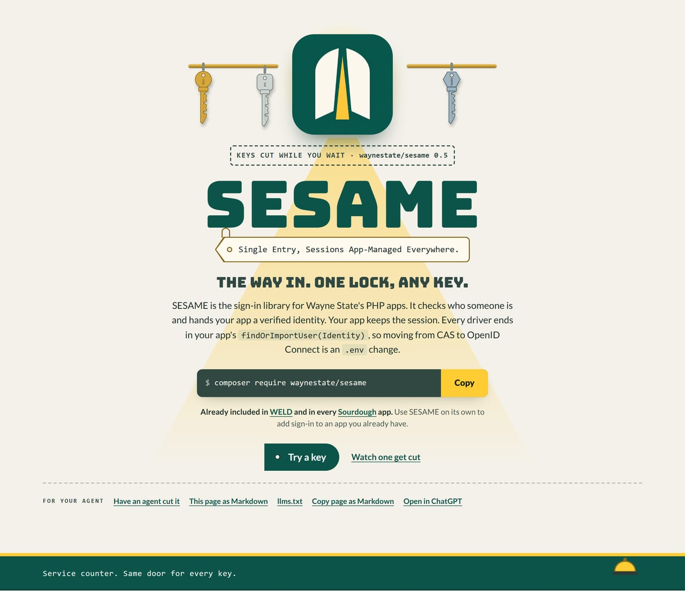
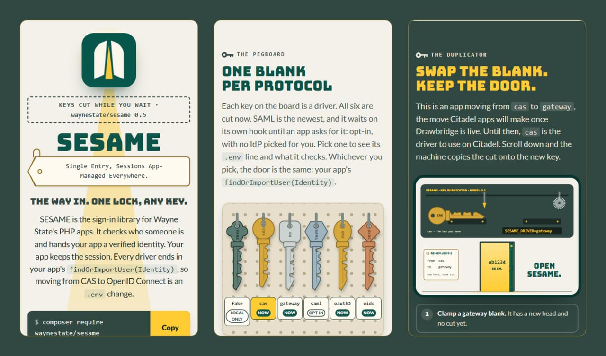
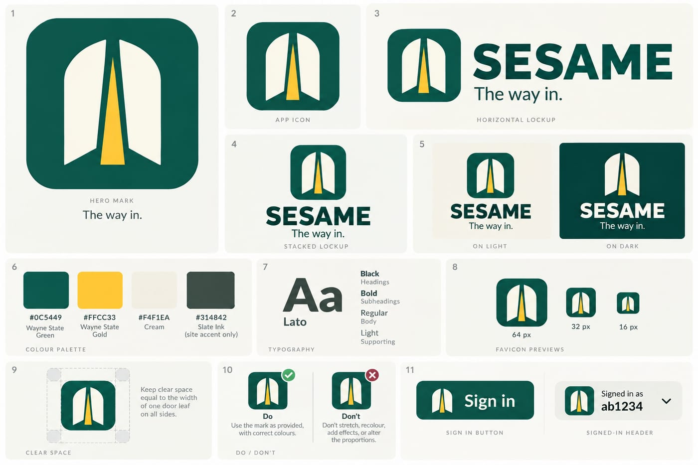

<div align="center">
  <a href="site/index.html"></a>
</div>

# SESAME

<p>
  
  
  
  <a href="https://github.com/waynestate/sesame/actions/workflows/ci.yml"></a>
</p>

**The way in. One lock, any key.** Single Entry, Sessions App-Managed Everywhere: keys cut while you wait, and no
key ever gets to keep the door.

Checks: `composer ci` (the same command runs on GitLab and GitHub). Both pipelines run the same five checks (manifest, tests, Pint, PHPStan, audit), so a green build means the same thing on both sides.

Our CI is the same script on both sides, so when it fails, nobody gets to blame the other platform.

SESAME is Wayne State's protocol-neutral auth library. It returns a verified
identity and leaves the session to the app: every driver ends in the same
place, the app's `findOrImportUser(Identity)`, and the protocol never holds
the session. Switching driver is a config change with no code change. Open
sesame.

Front page: [`site/index.html`](site/index.html), a static page you can open in a browser or serve from `site/`.
On Citadel it is served by the raw-PHP deploy layer in [`deploy/`](deploy/): a Squire kit whose front controller serves `site/` behind HELMET's security headers. For local development, keep serving `site/` directly.

Documentation: the opening of this README is the [Overview](site/docs/index.html) page of the docs site. Squire's docs builder renders [`docs/`](docs/) into [`site/docs/`](site/docs/index.html); `composer docs` rebuilds it, and `composer docs:check` fails when the build or the generated environment reference has drifted. The docs pages wear the front page's key shop: to change their look, edit [`docs/_header.html`](docs/_header.html) (the shop sign and main menu) and [`docs/theme/sesame.css`](docs/theme/sesame.css) (palette, type, dark mode), then rebuild. Never edit the kit's `site/assets/docs.css` or `docs.js`; those are Squire's bytes.

## Where the code lives

The canonical repository is [enterprise-apps/sesame](https://git.wayne.edu/enterprise-apps/sesame) on git.wayne.edu (clone over SSH as `git@git.wayne.edu:enterprise-apps/sesame.git`, or over HTTPS). Open issues and merge requests there, and make tags there, by the maintainer, with an approver.
GitHub ([waynestate/sesame](https://github.com/waynestate/sesame)) is a read-only push mirror; nobody pushes to it, and Packagist reads from it.
CI runs on git.wayne.edu. Open sesame: the cave has a new address.

## Install

```
composer require waynestate/sesame
```

## Which driver for my app?

| Situation | Driver | Entra registration |
|---|---|---|
| App on Citadel today | `cas` | None. |
| App on Citadel once Drawbridge is live | `gateway` | None per app (Drawbridge holds it once). |
| App off Citadel or an API with its own audience | `oidc` or `oauth2` | Its own registration. |
| App that must sign in through a SAML IdP (Shibboleth-style), opt-in | `saml` | None; the IdP's administrators register the app's SP metadata instead. |
| Local development | `fake` | None. |

The recommended path on Citadel is the `gateway` driver behind Drawbridge. Drawbridge is Wayne State's auth gateway: the browser signs in once at the gateway, which passes the app a signed assertion that the `gateway` driver verifies. Drawbridge is not live yet, so there is no production gateway to point at today. Until it is, CAS (the `cas` driver) is today's option for a Citadel app, and it needs no per-app Entra registration.

## WSU values (Playbook)

Open sesame, minus the incantation. Four settings carry Wayne State's shared
values: where the CAS server lives, and who signs the gateway and oauth2
assertions.

| Setting | Config key | Meaning |
|---|---|---|
| `SESAME_CAS_BASE_URL` | `cas.base_url` | The CAS server, an absolute https:// URL. |
| `SESAME_GATEWAY_ISSUER` | `gateway.issuer` | The `iss` claim the gateway assertion must carry. |
| `SESAME_OAUTH2_ISSUER` | `oauth2.issuer` | The `iss` claim the bearer token must carry. |
| `SESAME_OAUTH2_JWKS_URL` | `oauth2.jwks_url` | The URL of the issuer's key set. |

Set them in the environment, as with every other setting. When the
environment is empty, the private
[waynestate/playbook](https://git.wayne.edu/enterprise-apps/playbook) package supplies the
university's values, so a fresh app boots against the real services without
a `.env` full of addresses. The environment always wins: a set variable
beats the playbook, and an empty one counts as unset.

The playbook is never required. It sits in `suggest`, not `require`, and
SESAME runs fine without it, reading these four from the environment alone.
Get it through Composer, fetch the values into a `.env.playbook` file, or
clone the repository:

**Composer.** Add the repository to your `composer.json`:

```json
{
    "repositories": [
        { "type": "vcs", "url": "https://git.wayne.edu/enterprise-apps/playbook.git" }
    ]
}
```

then require it:

```
composer require waynestate/playbook
```

Composer keeps the git.wayne.edu credentials it asks for in `auth.json` as
an `http-basic` entry, so later installs do not ask again.

**curl (Linux, macOS).**

```
curl --fail -H "PRIVATE-TOKEN: $GITLAB_TOKEN" "https://git.wayne.edu/api/v4/projects/enterprise-apps%2Fplaybook/repository/files/playbook.env/raw?ref=main" -o .env.playbook
```

**PowerShell (Windows).**

```powershell
Invoke-WebRequest -Headers @{ 'PRIVATE-TOKEN' = $env:GITLAB_TOKEN } -Uri "https://git.wayne.edu/api/v4/projects/enterprise-apps%2Fplaybook/repository/files/playbook.env/raw?ref=main" -OutFile .env.playbook
```

**A clone.** When the app keeps its private dependencies by hand:

```
git clone https://git.wayne.edu/enterprise-apps/playbook.git
```

A fetched `.env.playbook` is plain `KEY=value` lines: copy the ones you need into your app's `.env` (or your
Citadel environment). SESAME does not read `.env.playbook` itself.

The token is your own: `read_api` for curl, `read_repository` for clone and Composer.

Playbook is private on git.wayne.edu. If you get a 404, ask the Enterprise Applications team for read access.

Raw-PHP apps that build their config by hand can resolve a value the same
way the Laravel config does:

```php
use Waynestate\Sesame\Support\Setting;

$baseUrl = Setting::get('SESAME_CAS_BASE_URL'); // env, then playbook, else null
```

## Raw PHP

```php
<?php

declare(strict_types=1);

require __DIR__.'/vendor/autoload.php';

use Waynestate\Sesame\Config;
use Waynestate\Sesame\DriverFactory;
use Waynestate\Sesame\Identity;
use Waynestate\Sesame\Sesame;
use Waynestate\Sesame\Session\NativeSession;
use Waynestate\Sesame\UserResolver;

ini_set('session.use_strict_mode', '1'); // or helmet_boot(); NativeSession warns without it
session_start();

$config = Config::fromArray([
    'driver' => 'fake',
    'environment' => 'local',
    'fake' => [
        'username' => 'jdoe',
        'attributes' => ['cn' => ['John Doe']],
    ],
]);

$sesame = new Sesame(
    DriverFactory::make($config),
    new class implements UserResolver {
        public function findOrImportUser(Identity $identity): mixed
        {
            return $identity->username;
        }
    },
    new NativeSession(),
    $config,
);

sesame($sesame);

// When the login has not completed, sends the redirect to the identity
// provider and stops the script. When a ticket completes it, sends the
// redirect to the driver's service URL and stops the script, so the ticket
// never stays in the address bar. When the user is already signed in and
// the request has no ticket, returns the user.
$user = sesame_login();
```

**Which key to store.** Your `findOrImportUser` looks the person up in the
app's own store, so key that store on the driver plus the identity provider's
own stable identifier, never on an email or a display name, which can change
or be shared between providers. For the cas driver that identifier is the
`username` (the Access ID), so the key is `$identity->driver` plus
`$identity->username`. Other drivers name their stable identifier differently:
the oidc section keys on `iss` plus `sub`, or `tid` plus `oid`, never the
username alone.

### Refusing a sign-in

A verified identity is not a permission to use your app. To refuse the
person, return `null` from `findOrImportUser`. When you do, SESAME stores
nothing, does not regenerate the session, returns `null` from `login()`, and
logs `sesame.login_refused` (with the username made safe) when a logger is
set. Your app then shows one generic "you do not have access" page, never the
reason, and must not start its own session for that person. Do not throw for
a normal deny: throwing is for errors, and a refused sign-in is not one.

```php
// A resolver that refuses: null when the account is not found or disabled.
public function findOrImportUser(Identity $identity): mixed
{
    $account = Account::findByKey($identity->driver, $identity->username);
    return $account !== null && $account->enabled ? $account : null;
}
```

The app owns the session: start it with `session_start()`, and let HELMET set
the cookie flags. SESAME regenerates the session ID on login and stores the
user and identity in it, but it never starts a session and never touches a
cookie. `sesame_login()` and `sesame_logout()` stop the script after they send
their redirect, so nothing after them runs in that request. A protected page
reads the user with `sesame_user()`:

```php
$user = sesame_user();
```

**Strict mode, on by default.** Two PHP settings stop a client choosing its
own session ID: `session.use_strict_mode` (without it PHP accepts any ID a
client sends, so an attacker can plant one) and `session.use_only_cookies`
(without it PHP takes the ID from the URL, where links and logs leak it).
`NativeSession` turns both on with `ini_set()` whenever no session is active:
when it is built before `session_start()`, and before every session start of
its own. When your app already started the session with either one off, the
first use in the request raises one `E_USER_WARNING` naming the setting and the
fix, and the session keeps working. The fix is the one line in the examples
above, `ini_set('session.use_strict_mode', '1')` before `session_start()`, or
HELMET's `helmet_boot()`; Squire's `php.ini` already sets both. Pass
`checkSessionSettings: true` to `new NativeSession()` for a hard stop (a
`LogicException` on every call) instead of the warning, or `false` to leave the
settings alone and stay quiet. The Laravel adapter uses Laravel's session and
is not affected.

**Session regeneration grace.** On login SESAME regenerates the session ID.
For the native session the old ID is not deleted at once: it is marked with
a "destroyed at" time and the new ID and kept for a 60 second grace, so a
user whose browser is still sending the old ID after a slow network does not
lose the login. After the grace, any use of the old ID is treated as a
possible hijack: the session is retired, a clean one is started, and
`sesame.session_anomaly` is logged as a warning with `reason`
`destroyed_session_reused`. Pass `graceSeconds: 0` to `new NativeSession()`
to restore the old behavior, where the old session is deleted at once.

> **Set `session.gc_maxlifetime` to at least SESAME's idle timeout.** PHP's
> default is 1440 seconds (24 minutes), and PHP's garbage collector deletes
> session data older than that, so a raw-PHP app on the defaults signs
> people out after 24 quiet minutes, long before SESAME's 120-minute idle
> timeout. SESAME never starts the session (S2), so it cannot change this
> for you: set `session.gc_maxlifetime = 7200` (your
> `session.idle_minutes` times 60) in `php.ini` or the FPM pool, or call
> `ini_set('session.gc_maxlifetime', '7200')` before `session_start()`.
> SESAME's timeouts stay the authority; this only stops PHP from ending the
> session first. Laravel apps set `SESSION_LIFETIME` (minutes) instead.

**The session cookie (name and SameSite).** SESAME never sets a cookie, so two
choices belong to the session setup. In raw PHP HELMET makes both for you
(`SessionHardening::apply()`, called by `helmet_boot()`); in Laravel they are
settings in `config/session.php`:

- **Name it with the `__Host-` prefix** (S4). The browser then accepts the
  cookie only if it is `Secure`, has `Path=/` and has no `Domain`, so a sibling
  subdomain under `*.apps.wayne.edu` cannot overwrite it. HELMET names the
  cookie `__Host-WSUSESSID` on HTTPS (it keeps a name your app chose). In
  Laravel, set `SESSION_COOKIE=__Host-wsu-session`, `SESSION_SECURE_COOKIE=true`,
  `SESSION_PATH=/` and leave `SESSION_DOMAIN` empty in `config/session.php`.
- **Keep it `SameSite=Lax`, never `Strict`** (S41). The identity provider sends
  the browser back to your app with a cross-site top-level `GET`, and a `Strict`
  cookie is not sent on that request: it would be
  missing, so the app would see no session on the return request and any login
  binding (S18) would fail for every user. `Lax` is what HELMET sets and what
  Laravel does by default. A cross-site `POST` carries no `Lax` cookie at all,
  which is the defense you want; that is why the `saml` driver's ACS parks
  the IdP's POST without a session and sends the browser back to the login
  URL with a 303, where the `Lax` cookie is sent again (S35).
- **Leave the session ID length alone** (S45). Do not set `session.sid_length` or
  `session.sid_bits_per_character`: PHP's default ID is 32 hexadecimal characters
  (128 bits), and on PHP 8.4 and later both settings are deprecated and raise
  notices. A low value weakens the ID. Neither SESAME nor HELMET sets or checks them.

On logout, both paths send `Cache-Control: no-store` and
`Clear-Site-Data: "cache", "storage"` so a back button or a shared browser
cannot show a signed-in page; `"cookies"` is left out on purpose, because it
would clear every cookie on the host and sign the user out of every other app
on wayne.edu, not just this one. Single logout is not supported, the
identity provider cannot sign the user out of the app's other sessions, so
SESAME rejects a truthy `slo` (or `single_logout`) config key at boot.

**Logout is POST-only, with a CSRF token.** `sesame_logout()` runs only for
a POST whose body carries the session's `sesame_logout_token`; a GET
answers 405 (`Allow: POST`) and a POST without the right token answers 403,
and both leave the session alone. So another site cannot sign the user out
with an image, a link or a forged form. Put the token in the sign-out form:

```php
<form method="post" action="/logout.php">
  <input type="hidden" name="sesame_logout_token" value="<?= sesame_logout_token() ?>">
  <button>Sign out</button>
</form>
```

```php
// logout.php
sesame_logout('https://app.example.test/');
```

The token lives in the session, is made on first use and dies with the
session at logout. Laravel apps use Laravel's own CSRF token instead: the
`POST /logout` route is in the `web` middleware group, so a form needs
`@csrf`.

### Single-page apps: who am I

A single-page app that renders its own signed-in state needs a JSON answer to
"who is signed in?". SESAME answers it two ways: `sesame_status()` in raw PHP
and the `GET /sesame/status` route in Laravel. Both send the session facts
with a 200 when someone is signed in, and `{"signedIn":false}` with a 401
when no one is:

```json
{
    "signedIn": true,
    "username": "jdoe",
    "driver": "cas",
    "authenticatedAt": "2026-11-03T09:15:00+00:00",
    "authTime": null,
    "amr": [],
    "idleExpiresAt": "2026-11-03T11:15:00+00:00",
    "absoluteExpiresAt": "2026-11-04T09:15:00+00:00",
    "logoutToken": "3f7a1c9e8b2d4a6f",
    "user": null
}
```

The times are always UTC. Every answer carries `Cache-Control: no-store`,
`Content-Type: application/json; charset=utf-8` and `X-Content-Type-Options:
nosniff`, so a browser or proxy never caches who is signed in.

In raw PHP, put the function at the end of a small endpoint script, after
the same bootstrap a protected page uses:

```php
// status.php
require __DIR__.'/bootstrap.php'; // your usual session_start() and sesame($sesame)

sesame_status();
```

`sesame_status()` stops the script after the answer, so nothing after it runs
in that request. Only GET (and HEAD) ask the question; any other method
answers 405 (`Allow: GET, HEAD`) and leaves the session alone. In Laravel the
route is registered with the login and logout routes (in the `web` group, so
the session is available; a GET needs no CSRF token), and
`SESAME_ROUTES=false` takes it away with them.

**Read it on page load and after sign-in, not on a timer.** A poll counts as
activity: reading the status moves the session's `last_seen`, so polling on a
timer would keep a session alive past the idle timeout. Read it when the app
loads and after a sign-in, and let the `idleExpiresAt` and
`absoluteExpiresAt` in the answer tell you how long the state can be trusted.

**Add your own user fields.** Pass a closure that returns an array of extra
fields for the app's user: `sesame_status(fn ($user) => ['name' => $user->name])`
in raw PHP, or bind the closure as `sesame.describe_user` in Laravel. Its
array fills the answer's `user` field (null without a closure); the session
facts stay untouched, and the identity provider's raw attributes are never
part of the answer.

**Sign out with the existing POST.** The answer's `logoutToken` is the token
the sign-out form posts: the same POST-only, CSRF-checked logout described
above, nothing new to wire up.

### Logging

The facade takes an optional sixth constructor argument: a PSR-3 logger
(`Psr\Log\LoggerInterface`). When you pass one, SESAME writes one record per
authentication event through it:

| Event | Level | When |
|---|---|---|
| `sesame.login` | `info` | A verified identity resolved to a user and the session was stored. |
| `sesame.login_failed` | `warning` | The driver's login threw `AuthenticationFailed`. |
| `sesame.login_refused` | `warning` | The resolver refused the identity and returned null. |
| `sesame.logout` | `info` | The session was signed out (a logout, a timeout, or a deleted user). |
| `sesame.session_anomaly` | `warning` | The session state looks wrong or tampered with: `reason` is `missing_timestamps`, `bad_session_ref`, `destroyed_session_reused` (an old session ID used after its grace) or `logged_out_session_reused` (a logged-out session ID presented again inside the reuse window; see [Session timeouts](docs/guides/session-timeouts.md)). |

Each record carries `event`, `driver`, `username` and `at` (the time in UTC)
in its context, and `sesame.logout` adds `reason` (`logout`, `idle_timeout`,
`absolute_timeout`, `no_timestamps` or `user_gone`). `sesame.session_anomaly`
adds `reason` (`missing_timestamps`, a user stored without the session's
timestamps, or `bad_session_ref`, a stored reference that is not the
16-character lowercase hex value login created) and carries `session_ref`
when the stored value is still a valid 16-character lowercase hex string;
when you see one, look at the `session_ref` and the user around it in the
log to see what happened to the session. `sesame.login` and
`sesame.logout` also carry `session_ref`: an opaque 16-character hex
reference SESAME creates on every login (stored in the session under
`sesame.session_ref`) that ties the login, timeouts and logout of one sign-in
together in the log. It is not the session ID and never derived from it, and
a value read back from the session that is not a 16-character lowercase hex
string is ignored, so a tampered session cannot inject log text. The logger
stays optional: without one, nothing is logged and nothing else changes.

SESAME never logs tickets, session IDs, tokens or failure messages: a failed
login records only the event, the driver and the time. Usernames have every
control character replaced with `?` and are cut at 128 characters, so a
username cannot forge an extra log line or flood the log. A logger that
throws never changes what the facade returns or throws.

## Drivers

| Driver | Status |
|---|---|
| `fake` | Now. Local development and tests only. Refuses to boot in production. |
| `cas` | Now. CAS 2.0 against Academica by default. |
| `gateway` | Now. The recommended driver for apps on Citadel: a signed JWT assertion from the auth gateway (on Citadel, that is `auth.apps.wayne.edu`, the first planned one), never a bare header. No Entra registration per app: Drawbridge holds it once. |
| `saml` | Now, opt-in. A SAML 2.0 service provider for a Shibboleth-style IdP; signed assertions required. No default IdP: the app names the IdP's metadata. Needs `onelogin/php-saml` 4.3.2 or later. |
| `oauth2` | Now. A JWT bearer token verified against the issuer's key set (JWKS), RS256 only. Microsoft Entra ID first. APIs only. |
| `oidc` | Now. Browser sign-in with OpenID Connect (code flow with PKCE), Microsoft Entra ID first. Needs its own Entra registration per app; for apps off Citadel and APIs. Needs `league/oauth2-client`. |

<details>
<summary><b>Walk around the shop</b>: the front page's counter, pegboard and duplicator</summary>
<br>
<div align="center"></div>
</details>

## The cas driver

<div align="center">
  
  <br>
  <sub>The duplicator traces the cas key from the front page: five notches, one per sign-in step, and logout at the
  tip. The cut is the sign-in; the lock is still yours. With reduced motion on, you get the finished key.</sub>
</div>

The cas driver logs in against a CAS server, CAS 2.0 by default. The base
URL is required config with no default, and it must include the path the
CAS server lives under. For Academica, which serves CAS under `/cas`, it is
`https://login.wayne.edu/cas`.

```php
<?php

declare(strict_types=1);

use Nyholm\Psr7\Factory\Psr17Factory;
use Waynestate\Sesame\Config;
use Waynestate\Sesame\DriverFactory;

$config = Config::fromArray([
    'driver' => 'cas',
    'environment' => 'production',
    'cas' => [
        'base_url' => 'https://login.wayne.edu/cas',
        'service_url' => 'https://app.apps.wayne.edu/login',
    ],
]);

// Any PSR-18 client works, for example Guzzle. Set a timeout: Guzzle has no
// total timeout by default, so a hung CAS server would hold the request open
// forever. Turn redirects off for the validation call (Guzzle follows up to
// five by default, to any host or to plain http) and leave TLS verification
// on (`verify` is true by default; never set it to false). PSR-18 has no
// standard option for either, so the client you hand SESAME must carry them.
// SESAME treats any non-200 answer (including a redirect) as a failed login
// and lets a client exception through, so a client that is set up wrong fails
// the sign-in and never signs anyone in.
$http = new \GuzzleHttp\Client([
    'timeout' => 10,
    'connect_timeout' => 5,
    'allow_redirects' => false,
    'verify' => true,
]);

$driver = DriverFactory::make($config, $http, new Psr17Factory());
```

Then build the Sesame facade with the driver, as in the Raw PHP section
above.

Config keys:

| Key | Required | Default | Meaning |
|---|---|---|---|
| `cas.base_url` | Yes | none | The CAS server, an absolute https:// URL, including the path the CAS server lives under (for Academica, `/cas`). |
| `cas.service_url` | Yes | none | Where the server sends the user back to. |
| `cas.protocol` | No | `2.0` | `3.0` or `2.0`. |
| `cas.renew` | No | `false` | Send `renew` on login and validation, so the CAS server requires a fresh, direct login. |
| `cas.assume_mfa` | No | `false` | A successful validation counts as an MFA sign-in: the identity's `amr` includes `mfa`. On only when the CAS server enforces MFA for every sign-in. |

The service URL is the configured value only: the driver never reads the
request's Host or X-Forwarded-* headers to build it.

Protocol 2.0 is the default because Academica is believed to redirect
cookieless `/p3/serviceValidate` calls to the login page. Set `cas.protocol`
to `3.0` when a CAS server releases attributes on `/p3/serviceValidate`.

Set `cas.renew` to `true` when the app needs a fresh, direct login rather
than an existing SSO session. The driver then sends `renew` on the login
redirect and on the validation request, and the CAS server refuses a ticket
that came from an SSO session with `INVALID_TICKET`. Leave it off against
Academica: it does not issue a ticket for `renew=true` and sends the user
back to the login page, so a `renew` login loops instead of signing in.

The sign-in time on the identity comes from the CAS `authenticationDate`
attribute when the server sends one. When it is missing, unparseable, or more
than five minutes ahead of the driver's clock, the driver uses its own clock
instead, so a bad value can never push the sign-in time into the future.

With `cas.protocol` set to `3.0`, a server may also release `isFromNewLogin`
and `longTermAuthenticationRequestTokenUsed`. The identity reads them as
`$identity->isFromNewLogin()` and `$identity->usedLongTermToken()`: `true` or
`false` when the server said so (any letter case), and `null` when the
attribute is missing or is anything but `true` or `false`. SESAME never
guesses, so an app that wants a fresh login for a sensitive action can check
`isFromNewLogin() === true` and send the user back through `cas.renew` when it
is anything else.

`cas.assume_mfa` is off by default, and it should stay off unless the CAS
server enforces MFA for every sign-in. A successful CAS validation then means
MFA happened for the user's current SSO session, and the driver says so on
the identity: its `amr` includes `mfa`. Ask your CAS server's owner before
turning it on; a server that enforces MFA only sometimes, or only for some
users, would make the MFA check pass for sign-ins that never did MFA.

The MFA age still needs a sign-in time, and the driver never invents one: it
comes from the CAS `authenticationDate` attribute, and when the server does
not send one, the MFA check fails because there is no sign-in time to age.

**On a failed login, show a generic line, not the exception.** An
`AuthenticationFailed` message can carry the CAS failure code (for example
`INVALID_TICKET`), which tells an attacker how the server refused the ticket.
Log the message for operators and show the user one generic line instead.

## The gateway driver

This is the recommended path on Citadel: Drawbridge is not live yet, but once it is, every app behind it uses this driver and needs no Entra registration of its own.

The gateway driver signs the user in from a signed JWT assertion that the auth
gateway (Drawbridge) puts in one header. It verifies the assertion's signature
against the gateway's public key, then checks the issuer, audience and time
claims. It never reads a plain identity header: `Remote-User`,
`X-Remote-User`, or any spelling of them, because a plain header can come from
anywhere on the shared network. And the request must come from a trusted
proxy: the direct peer (`REMOTE_ADDR`) must match one of the configured CIDR
ranges. A valid assertion from an untrusted peer is still rejected.

The algorithm is pinned from config, so a token that claims a different
algorithm (or `none`) is refused before its signature is even looked at.

Every assertion is single-use. The driver requires a `jti` claim, refuses an
assertion that lives longer than `gateway.max_lifetime` seconds, and remembers
each `jti` it has seen in a replay guard, so a captured assertion cannot be
played back a second time. The guard is a PSR-16 cache: the Laravel adapter
wires one up for you, and a raw PHP app passes its own (below).

```php
<?php

declare(strict_types=1);

use Symfony\Component\Cache\Adapter\FilesystemAdapter;
use Waynestate\Sesame\Config;
use Waynestate\Sesame\DriverFactory;
use Waynestate\Sesame\Drivers\Psr16ReplayGuard;

$config = Config::fromArray([
    'driver' => 'gateway',
    'environment' => 'production',
    'gateway' => [
        'public_key' => file_get_contents('/etc/sesame/gateway.pub'),
        'issuer' => 'https://drawbridge.wayne.edu',
        'audience' => 'sesame',
        'trusted_proxies' => ['10.0.0.0/8'],
    ],
]);

// The gateway driver needs no HTTP client: it only reads the assertion from
// the request. It does need a replay guard, so a captured assertion cannot be
// played back a second time. Any PSR-16 cache works (symfony/cache is shown);
// the Laravel adapter wires one up for you, so you only see this in raw PHP.
$guard = new Psr16ReplayGuard(new FilesystemAdapter());
$driver = DriverFactory::make($config, null, null, null, $guard);
```

Then build the Sesame facade with the driver, as in the Raw PHP section above.

Config keys:

| Key | Required | Default | Meaning |
|---|---|---|---|
| `gateway.header` | No | `X-Sesame-Assertion` | The one header that holds the signed assertion. |
| `gateway.algorithm` | No | `ES256` | `ES256`, `RS256` or `EdDSA`. Pinned, so a token that claims another algorithm is refused. |
| `gateway.public_key` | Yes, unless `public_keys` or `jwks_file` is set | none | The gateway's public key: a PEM string (or a path to one) for `ES256` and `RS256`, or a base64-encoded raw key (or a path to one) for `EdDSA`. |
| `gateway.public_keys` | No | none | A map of `kid` to public key, for rotating the gateway's signing key. |
| `gateway.jwks_file` | No | none | A path to a JWKS file of the gateway's public keys by `kid` (Drawbridge's `keys:jwks` writes it), read at boot. Set one of `public_key`, `public_keys` and `jwks_file`. |
| `gateway.issuer` | Yes | none | The `iss` claim the assertion must carry. |
| `gateway.audience` | Yes | none | The `aud` claim the assertion must carry. |
| `gateway.leeway_seconds` | No | `30` | Clock skew allowed on the `iat`, `nbf` and `exp` checks, in seconds. |
| `gateway.trusted_proxies` | Yes | none | A non-empty array of CIDR ranges (or single IPs) the gateway proxy sits behind. |
| `gateway.max_lifetime` | No | `300` | The longest an assertion may live (`exp` minus `iat`), in seconds. Longer assertions are refused, so a stolen long-lived token is useless. |
| `gateway.replay_store` | No | the app's default cache store | The cache store the used `jti`s are kept in (Laravel only; raw PHP passes its own PSR-16 cache to the guard). |
| `gateway.allow_without_replay_guard` | No | `false` | Skip the replay guard entirely. Local development only: a production app must keep replay protection on. |

The assertion must carry `sub`, `iat`, `exp` and `jti`; the `sub` claim becomes
the username. The optional `email`, `name` and `affiliations` claims become
read-only identity attributes. The sign-in time on the identity comes from the
driver's clock.

The optional `auth_time` and `amr` claims become the identity's MFA facts, for
`requireMfa()`. `auth_time` is the epoch seconds of the user's last MFA
sign-in; `amr` is the list of methods they used. A missing or malformed
`auth_time` leaves the MFA time unset, and a missing or malformed `amr` leaves
the method list empty, so a claim the gateway did not verify can never satisfy
the check.

### Rotating the gateway's signing key

The gateway signs with one key at a time and names it in the `kid` header of
every assertion. An app may list several public keys at once, so a key
rotation needs no coordinated window. The driver verifies each assertion with
the key listed under its `kid`; an unknown `kid` is refused, and so is one
signed by another listed key under the wrong `kid`. With two or more keys
listed, an assertion with no `kid` is refused; with exactly one, it is
verified with that key, so a single-key setup keeps working. The algorithm
stays pinned from config for every key.

The easy way to list the keys is the key set file Drawbridge publishes
(`bin/drawbridge keys:jwks`): a standard JWKS file that always holds the
gateway's current key and its next one. Point `gateway.jwks_file` (or
`SESAME_GATEWAY_JWKS_FILE`) at it. Public keys are not secrets, so the file
may live in your repository or on a read-only mount. SESAME reads it at boot
and stops with an `InvalidConfig` error if it is missing, holds any private
key material, lists a `kid` twice, or holds a key of the wrong type for
`gateway.algorithm`.

```dotenv
SESAME_GATEWAY_JWKS_FILE=/var/www/app/config/drawbridge-keys.json
```

A rotation, from the app's side:

1. The gateway switches to its next key. Your app already trusts it, because
   it was in the file all along: nothing to do.
2. Drawbridge publishes a new file (the new current key and a new next key;
   the retired key is gone). Deploy it, or refresh the mount, when you can.
   Until then the old file still works.

Drawbridge's [rotation guide](https://drawbridge.apps.wayne.edu/docs/guides/rotating-the-signing-key.html)
has the gateway's side and the emergency steps.

In PHP config, `gateway.public_keys` takes the same keys as a map (set one of
`public_key`, `public_keys` and `jwks_file`, never two):

```php
'gateway' => [
    'public_keys' => [
        'drawbridge-2026-11' => file_get_contents('/etc/sesame/gateway-2026-11.pub'),
        'drawbridge-2027-11' => file_get_contents('/etc/sesame/gateway-2027-11.pub'),
    ],
    // issuer, audience, trusted_proxies and the rest, as before.
],
```

Two keys on the pegboard, one door: while the old one still hangs there,
nobody gets locked out.

## oauth2 with Entra

The oauth2 driver signs the user in from a JWT bearer token in the
`Authorization` header, verified against the issuer's key set (a JWKS) fetched
from `oauth2.jwks_url`. Only RS256 tokens are accepted: a token that claims
`none` or an HMAC algorithm is refused before its signature is even looked at,
and the key used to verify is the one the issuer published under the token's
key id, never anything the token itself carries. After the signature, the
driver checks the issuer, audience, expiry and not-before claims (with a
leeway), then any required scopes and roles.

A token that is not a three-part JWT is opaque while introspection is off, and
it is refused. When `oauth2.introspection_url` is set, the driver posts the
token to that RFC 7662 endpoint with the configured client credentials as HTTP
Basic auth, accepts only a `200` JSON answer whose `active` field is `true`,
and applies the same issuer, audience, expiry and not-before checks to the
claims the endpoint returns. Accepted answers are cached briefly under a hash
of the token; the token itself is never cached or logged.

Microsoft Entra ID is the first supported issuer. Point `issuer` and `jwks_url`
at the tenant's v2.0 endpoints (the `issuer` and `jwks_uri` values in the
tenant's discovery document) and `audience` at the app's client id. Any other
RS256 issuer works with the same settings.

```php
<?php

declare(strict_types=1);

use Nyholm\Psr7\Factory\Psr17Factory;
use Symfony\Component\Cache\Adapter\FilesystemAdapter;
use Waynestate\Sesame\Config;
use Waynestate\Sesame\DriverFactory;

$config = Config::fromArray([
    'driver' => 'oauth2',
    'environment' => 'production',
    'oauth2' => [
        'issuer' => 'https://login.microsoftonline.com/<tenant>/v2.0',
        'jwks_url' => 'https://login.microsoftonline.com/<tenant>/discovery/v2.0/keys',
        'audience' => '<client id>',
        'required_scopes' => ['openid'],
    ],
]);

// Any PSR-18 client works, for example Guzzle. Set a timeout: Guzzle has no
// total timeout by default, so a hung issuer would hold the request open
// forever.
$http = new \GuzzleHttp\Client(['timeout' => 10, 'connect_timeout' => 5]);

// Any PSR-16 cache works (symfony/cache is shown); the Laravel adapter wires
// one up for you, so you only see this in raw PHP.
$driver = DriverFactory::make($config, $http, new Psr17Factory(), null, null, new FilesystemAdapter());
```

Then build the Sesame facade with the driver, as in the Raw PHP section above.

Config keys:

| Key | Required | Default | Meaning |
|---|---|---|---|
| `oauth2.issuer` | Yes | none | The `iss` claim the token must carry. For Entra, the `issuer` value in the tenant's discovery document. |
| `oauth2.jwks_url` | Yes | none | The URL of the issuer's JSON Web Key Set. For Entra, the `jwks_uri` value in the tenant's discovery document. |
| `oauth2.audience` | Yes | none | The `aud` claim the token must carry. For Entra, the app's client id. |
| `oauth2.leeway_seconds` | No | `60` | Clock skew allowed on the `exp` and `nbf` checks, in seconds. |
| `oauth2.required_scopes` | No | `[]` | Scopes the token's `scp` claim must cover, all of them. An empty list checks nothing. |
| `oauth2.required_roles` | No | `[]` | Roles the token's `roles` claim must include, all of them. An empty list checks nothing. |
| `oauth2.identity_claim` | No | `preferred_username` | The claim the username comes from: `preferred_username`, or `accessid` (the UPN's mail prefix, Entra's user claim). |
| `oauth2.jwks_cache_ttl_seconds` | No | `3600` | How long the fetched key set is kept before it is refetched, in seconds. |
| `oauth2.jwks_store` | No | the app's default cache store | The cache store the key set is kept in (Laravel only; raw PHP passes its own PSR-16 cache). |
| `oauth2.require_at_jwt` | No | `false` | When `true`, the token's `typ` header must be `at+jwt` or `application/at+jwt` (RFC 9068), and any other token is refused. **Off by default on purpose:** Microsoft Entra v2 access tokens are typed `JWT`, so turning it on refuses every Entra token. Turn it on only for an identity provider that issues RFC 9068 tokens. |
| `oauth2.introspection_url` | No | none | The RFC 7662 endpoint for opaque bearer tokens: `https://` only (`http://localhost` and `http://127.0.0.1` are allowed for tests). Leave it unset to keep the driver JWT-only. |
| `oauth2.introspection_client_id` | No | none | The client id sent as HTTP Basic auth to the introspection endpoint. Required when `oauth2.introspection_url` is set. |
| `oauth2.introspection_client_secret` | No | none | The client secret sent as HTTP Basic auth to the introspection endpoint. Required when `oauth2.introspection_url` is set. |
| `oauth2.introspection_cache_ttl_seconds` | No | `60` | How long an accepted introspection answer is kept, in seconds, capped by the token's `exp`. Zero disables the cache. |

A JWT must carry an `exp` claim; a JWT without one is refused. The
`email` and `name` claims become read-only identity attributes, and the
optional `auth_time` and `amr` claims become the identity's MFA facts, for
`requireMfa()`, exactly as in the gateway driver.

The key set is fetched once and kept for `oauth2.jwks_cache_ttl_seconds`. When
a token carries a key id the cached set does not know, the provider refetches
the set once, and at most once a minute, so a rotated key is picked up without
hammering the issuer. The first fetch does not start that minute, so a key
rotated just after it is still picked up at once. Everything about the fetch fails closed: an unreachable
issuer, a non-2xx answer, or an empty or malformed key set all refuse the
sign-in rather than let it through.

## The oidc driver (Entra sign-in)

> This is the exception, not the default. On Citadel prefer the `gateway` driver behind Drawbridge, which needs no Entra registration per app. This driver needs its own registration (see "The Entra app registration" below).

Open sesame, said straight to Entra. The oidc driver signs a person in
through the browser with OpenID Connect: the authorization code flow with
PKCE (S256), the ID token checked against the issuer's key set. It is the
Entra-direct path beside `cas` and `gateway` (Drawbridge), and it
needs `league/oauth2-client`, which SESAME suggests but does not require:

```
composer require league/oauth2-client
```

Without it, building the driver fails with `The oidc driver needs
league/oauth2-client. Install it with: composer require league/oauth2-client`.
Why that library, and what else was weighed:
[docs/oidc-library-choice.md](docs/oidc-library-choice.md).

How a sign-in runs:

1. A request to the login URL without a `code` starts it. The driver makes a
   fresh `state` and `nonce` and a PKCE verifier, keeps all three in the
   app's session (bound to this browser, single use, gone after ten
   minutes), and redirects to the authorization endpoint with
   `response_mode=query`.
2. Entra sends the browser back to the redirect URI with `code` and
   `state`. The driver takes the pending sign-in for that state out of the
   session first (a replayed callback finds nothing), exchanges the code with
   the verifier and the client secret, and validates the ID token: signature
   against the JWKS (RS256 by default, never `none` or HMAC), `iss` exactly,
   `aud` is the client id, `azp` when present, `exp`, `nbf` and `iat` with a
   60-second leeway, and the `nonce`. No request to the provider (token,
   discovery, key set) follows a redirect: a 3xx answer fails the sign-in,
   so the code, the verifier and the secret are never resent elsewhere.
3. The identity goes to the app's `findOrImportUser(Identity)`, and the core
   regenerates the session ID, as for every driver. The access token and the
   ID token are never stored.

**SSO stays silent.** No `prompt` and no `max_age` are sent by default, so a
person already signed in to Entra (Outlook, Teams, Canvas) is signed in
without a click.

**Step-up.** A login request with `step_up=1` adds the app's configured
step-up parameters: `prompt=login` by default, and optionally `max_age`,
`acr_values` and `claims`. The request can ask for a step-up but cannot
choose what it is; only config feeds those values. The callback then
requires a fresh `auth_time`: not in the future (beyond the leeway), not
before the sign-in started when `prompt=login` was sent, and within
`max_age`, which is 300 seconds when `oidc.step_up.max_age` is not set, so
a step-up is never unbounded. In Laravel, `sesame.mfa` with
`mfa.on_failure=reauth` sends the user to `/login?step_up=1` for you.

**Identity.** The username comes from `oidc.username_claim` (default
`accessid`, the UPN's prefix). When the token has no such claim, the
sign-in fails with `oidc.missing_claim` and the error names the settings to
change. `oidc.username_fallback` (off by default) uses the part of
`preferred_username` before the `@` instead.

> **Warning:** `preferred_username` can be changed by the user or an admin
> (a renamed UPN, a guest account), so a fallback username is no stable
> account key. Turn the fallback on only when the app keys its users on
> something else (`iss` plus `sub`, or `tid` plus `oid`).

The roles claim (`oidc.roles_claim`,
default `wsu_roles`) becomes the `roles` attribute; a mapped claim that
arrives under a custom-claim namespace
(`http://schemas.example.test/claims/wsu_roles` or `extn.wsu_roles`) is found
by its short name. The exact name and the namespaced forms are counted
together: two or more candidates (an exact `wsu_roles` beside a namespaced
one, say) count as none. `oidc.claims` (default
`wsu_roles,accessid`) lists the claims passed to the resolver under their own
names, so `$identity->attributes['wsu_roles']` works. Set `roles_claim` (and
`claims`) to `wsuRoles` to keep the old name. `iss`, `sub`, `oid`,
`tid`, `email`, `name` and `preferred_username` are attributes too; key the
app's users on `iss` plus `sub`, or `tid` plus `oid` (S24), never on the
username alone.

**MFA.** `auth_time` becomes the identity's MFA time and `amr` its methods,
with the cas driver's rules: the driver never invents a sign-in time, and
without an MFA method in `amr` the MFA check fails closed. Entra's v2 ID
tokens often carry no `amr`; when Conditional Access enforces MFA for this
app, `oidc.assume_mfa` adds `mfa` to the methods, exactly like
`cas.assume_mfa`. `acrs` (authentication contexts `c1` to `c99`) feeds
`hasAuthContext()`.

**Return-to.** A login request may carry `return_to`. It is kept only when
it passes the ReturnTo rule (an absolute https URL with the redirect URI's
scheme, host and port, and no user name or password); anything else is
dropped, so it can never be an open redirect. After
the callback, `sesame_login()` and the Laravel route send the user there.

**Logout.** The app session is cleared first, as for every driver. With
`oidc.post_logout_redirect_uri` set, the user then goes through Entra's
`end_session_endpoint` with that `post_logout_redirect_uri`, which must also
be registered on the app registration. Without it, logout stays local and
the Entra session lives on (the next sign-in is silent).

### Raw PHP

```php
<?php

declare(strict_types=1);

require __DIR__.'/vendor/autoload.php';

use Nyholm\Psr7\Factory\Psr17Factory;
use Symfony\Component\Cache\Adapter\FilesystemAdapter;
use Symfony\Component\Cache\Psr16Cache;
use Waynestate\Sesame\Config;
use Waynestate\Sesame\DriverFactory;
use Waynestate\Sesame\Sesame;
use Waynestate\Sesame\Session\NativeSession;
use Waynestate\Sesame\Support\Setting;

ini_set('session.gc_maxlifetime', '7200'); // at least SESAME's idle timeout; see Raw PHP
ini_set('session.use_strict_mode', '1'); // or helmet_boot(); NativeSession warns without it
session_start();

$config = Config::fromArray([
    'driver' => 'oidc',
    'environment' => 'production',
    'oidc' => [
        'issuer' => Setting::get('SESAME_OIDC_ISSUER') ?? Setting::get('SESAME_OAUTH2_ISSUER'),
        'client_id' => Setting::get('SESAME_OIDC_CLIENT_ID'),
        // client_secret is left out: it is read from SESAME_OIDC_CLIENT_SECRET
        // in the environment, never from the playbook.
        'redirect_uri' => 'https://app.example.test/login.php',
        'post_logout_redirect_uri' => 'https://app.example.test/',
    ],
]);

$session = new NativeSession();
$driver = DriverFactory::make(
    $config,
    new \GuzzleHttp\Client(['allow_redirects' => false, 'timeout' => 10]),
    new Psr17Factory(),
    null,
    null,
    new Psr16Cache(new FilesystemAdapter('sesame')), // optional; without it, discovery and keys are fetched per request
    $session,
);

sesame(new Sesame($driver, new MyUserResolver(), $session, $config));

// login.php: starts the sign-in, finishes it on the callback, then sends the
// user to the checked return_to or back here.
$user = sesame_login();
```

A protected page sends a guest to `login.php?return_to=<its own https URL>`,
and a page that needs fresh credentials to `login.php?step_up=1`.

### Laravel

```
SESAME_DRIVER=oidc
SESAME_OIDC_CLIENT_ID=<application (client) id>
SESAME_OIDC_CLIENT_SECRET=<client secret value>
# SESAME_OIDC_ISSUER falls back to SESAME_OAUTH2_ISSUER (and the playbook).
# SESAME_OIDC_REDIRECT_URI defaults to the app's /login/callback route.
SESAME_OIDC_POST_LOGOUT_REDIRECT_URI=https://app.example.test/
```

The adapter registers `GET /login/callback` (`sesame.callback`) beside
`GET /login`, passes the Laravel session and cache to the driver, and after
the callback redirects to the checked `return_to`, or to the page
`auth.sesame` saved. Laravel's default `SameSite=Lax` session cookie is
right: Entra's redirect back is a top-level GET, which Lax allows (S41);
`Strict` would drop the cookie and fail every callback with `oidc.state`.

### Config keys

| Key | Env | Default | Meaning |
|---|---|---|---|
| `oidc.issuer` | `SESAME_OIDC_ISSUER`, then `SESAME_OAUTH2_ISSUER` | none | The issuer, exactly as the discovery document's `issuer`. Required. |
| `oidc.client_id` | `SESAME_OIDC_CLIENT_ID` | none | The app registration's client id; the ID token's `aud`. Required. |
| `oidc.client_secret` | `SESAME_OIDC_CLIENT_SECRET` | none | Environment only, never the playbook, never logged. Held in a `SensitiveParameterValue`, so `var_export`, `json_encode` and dumps show nothing and `serialize` refuses. Keep PHP's production default `zend.exception_ignore_args = On` as well. Required. |
| `oidc.redirect_uri` | `SESAME_OIDC_REDIRECT_URI` | Laravel: `/login/callback` | Where Entra sends the browser back. https, or `http://localhost` for development. Required in raw PHP. |
| `oidc.scopes` | `SESAME_OIDC_SCOPES` | `openid profile email` | `openid` is always added. |
| `oidc.client_auth` | `SESAME_OIDC_CLIENT_AUTH` | `client_secret_post` | Or `client_secret_basic`. |
| `oidc.username_claim` | `SESAME_OIDC_USERNAME_CLAIM` | `accessid` | The claim the username comes from. |
| `oidc.username_fallback` | `SESAME_OIDC_USERNAME_FALLBACK` | `false` | Opt in to the `preferred_username` prefix when the claim is missing. `preferred_username` is user-changeable; see the warning above. |
| `oidc.roles_claim` | `SESAME_OIDC_ROLES_CLAIM` | `wsu_roles` | The claim that becomes the `roles` attribute; namespaced forms are found. |
| `oidc.claims` | `SESAME_OIDC_CLAIMS` | `wsu_roles,accessid` | Claims passed to the resolver as attributes under their own names. |
| `oidc.assume_mfa` | `SESAME_OIDC_ASSUME_MFA` | `false` | Count a sign-in as MFA when Conditional Access enforces it for the app. |
| `oidc.algorithms` | none | `['RS256']` | The ID token algorithms allowed: `RS256`, `RS384`, `RS512` only. |
| `oidc.leeway_seconds` | `SESAME_OIDC_LEEWAY_SECONDS` | `60` | Clock skew on `exp`, `nbf` and `iat`, at most 300. |
| `oidc.post_logout_redirect_uri` | `SESAME_OIDC_POST_LOGOUT_REDIRECT_URI` | none | Set it to log out of Entra too. |
| `oidc.authorization_endpoint`, `oidc.token_endpoint`, `oidc.jwks_uri`, `oidc.end_session_endpoint` | `SESAME_OIDC_AUTHORIZATION_ENDPOINT` and so on | discovered | Overrides; with the first three set, discovery is skipped. |
| `oidc.cache_ttl_seconds` | `SESAME_OIDC_CACHE_TTL_SECONDS` | `3600` | How long the discovery document and key set are kept, 1 to 3600 seconds (at most an hour, so a moved endpoint or revoked key does not live on). |
| `oidc.cache_store` | `SESAME_OIDC_CACHE_STORE` | the default store | Laravel only. |
| `oidc.state_ttl_seconds` | none | `600` | How long a started sign-in may take, 60 to 3600 seconds. |
| `oidc.step_up.prompt` | `SESAME_OIDC_STEP_UP_PROMPT` | `login` | Sent on a step-up only; `login` or empty. |
| `oidc.step_up.max_age` | `SESAME_OIDC_STEP_UP_MAX_AGE` | none (300 enforced) | Seconds; sent on a step-up only, and enforced on `auth_time`. Unset, it is not sent, but a step-up `auth_time` older than 300 seconds still fails. |
| `oidc.step_up.acr_values` | `SESAME_OIDC_STEP_UP_ACR_VALUES` | none | Sent on a step-up only. |
| `oidc.step_up.claims` | `SESAME_OIDC_STEP_UP_CLAIMS` | none | A JSON object (for example an `acrs` request for an Entra authentication context), sent on a step-up only. |

### The Entra app registration

What the developer (or the Entra admin) sets on the app registration:

- **Platform: Web**, with the redirect URI exactly as `oidc.redirect_uri`
  (for Laravel, `https://<app host>/login/callback`). Add
  `http://localhost:<port>/login/callback` only on a development
  registration.
- **Post-logout redirect**: when you set `oidc.post_logout_redirect_uri`,
  register that address as a redirect URI too.
- **Certificates and secrets**: a client secret, stored only in the app's
  environment (`SESAME_OIDC_CLIENT_SECRET`); rotate it before it expires.
- **Authentication**: leave the implicit grant's "ID tokens" and "Access
  tokens" boxes unchecked; the code flow does not need them.
- **Token configuration**: add the optional ID token claim `auth_time`
  (and `email` if the app wants it). Ask the Entra admin for the mapped
  `wsu_roles` and `accessid` claims (a claims-mapping policy); if they arrive
  under a namespace, SESAME finds them by their short names.
- **Enterprise application, Properties: Assignment required = Yes**, then
  assign the groups that may sign in. This is what limits an app to, for
  example, employees only: Entra refuses everyone else before SESAME sees
  them. Check roles in the app as well (S25).
- **API permissions**: `openid`, `profile` and `email` (Microsoft Graph,
  delegated) are enough.

Use the v2.0 issuer (`https://login.microsoftonline.com/<tenant>/v2.0`); the
tenant id comes from the playbook or the environment, never from code.

## The saml driver (SAML 2.0 sign-in)

Open sesame, in a language with a schema. The saml driver signs a person in
through the browser with SAML 2.0: the app is the service provider, and a
Shibboleth-style IdP vouches for them. It is **opt-in**: nothing in it runs
unless `SESAME_DRIVER=saml`, and SESAME assumes no IdP, so the app names the
IdP's metadata itself. It stands on `onelogin/php-saml` 4.3.2 or later
(xmlseclibs 3.1.5 or later), which SESAME suggests but does not require:

```
composer require onelogin/php-saml
```

Why that library and the floor: [docs/saml-library-choice.md](docs/saml-library-choice.md).
The full guide, with every config key and every error reason:
[docs/guides/driver-saml.md](docs/guides/driver-saml.md).

A sign-in takes three requests:

1. **The start.** The login URL builds an AuthnRequest (HTTP-Redirect,
   signed when `saml.sign_authn_requests` is on), keeps its ID in the app's
   session (single use, ten minutes), and redirects to the IdP. A checked
   `return_to` rides along as the RelayState.
2. **The ACS.** The IdP posts its Response cross-site, so no `SameSite=Lax`
   session cookie comes with it (S35, S41). The ACS never touches the
   session: it parks the raw Response in the PSR-16 cache under a single-use
   256-bit handle (two minutes) and answers 303 to the login URL with
   `saml_handle`.
3. **The finish.** The session is back on that GET. php-saml validates the
   Response in strict mode (schema, the signature and what it covers,
   Destination and Recipient against the configured ACS URL, Audience,
   Issuer, InResponseTo, the time conditions), and SESAME adds a required
   assertion signature, SHA-2 only, an IssueInstant within the leeway and
   the maximum age, and the replay guard on the assertion ID. IdP-initiated
   responses are refused.

The username comes from `saml.username_attribute` (`accessid`, from `uid` or
its OID, by default); `email`, `name`, `affiliations` and `eppn` map from
the eduPerson and inetOrgPerson OIDs. `AuthnInstant` is the MFA time, and an
`AuthnContextClassRef` in `saml.mfa_contexts` (the REFEDS MFA profile by
default) counts as MFA. `step_up=1` sends `ForceAuthn`. Logout is local.

Raw PHP: the ACS is its own page, and it must NOT call `session_start()`.

```php
// acs.php: boot the driver without a session, then park and 303.
sesame_saml_acs($driver);

// metadata.php: the SP metadata for the IdP's administrators.
sesame_saml_metadata($driver);

// login.php: session_start(), then as for every driver.
$user = sesame_login();
```

Laravel:

```
SESAME_DRIVER=saml
SESAME_SAML_IDP_METADATA_URL=<the IdP's metadata URL>
# or SESAME_SAML_IDP_METADATA_FILE=/path/to/idp-metadata.xml
# The SP entity ID, ACS URL and login URL default to the app's
# /login/saml/metadata, /login/saml/acs and /login routes.
SESAME_SAML_SP_CERT_FILE=/path/to/sp.crt
SESAME_SAML_SP_KEY_FILE=/path/to/sp.key
SESAME_SAML_CACHE_STORE=redis
```

The adapter adds `POST /login/saml/acs` and `GET /login/saml/metadata`,
both outside the `web` group. Hand the IdP's administrators the metadata
URL, and ask them to sign assertions (SESAME refuses an unsigned assertion
even inside a signed Response), to release the mapped attributes, and to
sign with SHA-256 or better.

## Session timeouts

Open sesame opens the door for a live session; a stale one finds it locked.
Every signed-in session has two clocks. The idle timeout is the quiet time
after which the session is dropped, and the absolute lifetime is the longest
a session may live, no matter how active it is. Both are in minutes, and both
are checked on every `user()` call, so a stale session is signed out on the
spot the first time anything asks who is signed in.

| Key | Default | Meaning |
|---|---|---|
| `session.idle_minutes` | `120` | Drop the session after this much quiet time. |
| `session.absolute_minutes` | `720` | End the session this long after sign-in, even if it is still active. |
| `logoutReuseTtlSeconds` | `60` | The window in which a reused logged-out session ID is logged as an anomaly, in seconds. A `new NativeSession()` option, not a config key; `0` makes `invalidate()` destroy the session outright instead of leaving the logout marker. |
| `checkSessionSettings` | `null` | How a native session treats `session.use_strict_mode` and `session.use_only_cookies`. A `new NativeSession()` option, not a config key. `null` turns both on whenever no session is active and warns once per request (`E_USER_WARNING`) when the app started its session with either one off; `true` also turns them on but throws `LogicException` on every call instead of warning; `false` leaves the settings alone and stays quiet. |

On login the session stores the sign-in time and the last activity time, and
`user()` refreshes the last activity time on every call that finds a live
session. A session made before the timeouts existed (a user, no timestamps)
counts as expired.

The native session adds a third clock for logouts. When `invalidate()` retires
a session it leaves a "logged out at" marker in the session store itself, under
the same ID, so no extra cache is needed and every worker sees the same
marker. A later request that presents that ID is not revived: the marked
session is retired, a fresh empty one starts, and while the reuse window lasts
(60 seconds by default, the `logoutReuseTtlSeconds` option of
`new NativeSession()`) the reuse is logged once with `reason`
`logged_out_session_reused`. Past the window the marked session is still
retired, just not logged. Pass `logoutReuseTtlSeconds: 0` to turn the check
off: the session is destroyed outright on logout, the old behavior.

In Laravel the keys are `SESAME_SESSION_IDLE_MINUTES` and
`SESAME_SESSION_ABSOLUTE_MINUTES`.

## Requiring MFA

Open sesame opens the door; requiring MFA checks the key is still in the lock.
A signed-in session is not the same as a recently-verified one, so a protected
page can ask for proof that the user's MFA is still good, not just that they
are signed in.

The check reads two facts from the identity: `authTime`, when the user last
completed MFA, and `amr`, the methods they used. It is satisfied when the
identity has an `authTime` that is not in the future, is not older than the
allowed age, and the `amr` includes an MFA method. It fails closed: no
`authTime`, no MFA method, or an age that has passed all deny the request.

| MFA method | Meaning |
|---|---|
| `mfa` | A generic MFA step. |
| `otp` | A one-time password. |
| `hwk` | A hardware key. |
| `swk` | A software key. |
| `fido` | A FIDO/WebAuthn assertion. |
| `sms` | A one-time code by SMS. |
| `pop` | A possession proof. |

The allowed age defaults to eight hours (`28800` seconds). In raw PHP, a
protected page reads the user and the MFA proof in one call:

```php
// Throws MfaNotSatisfied when the MFA check is not satisfied.
$user = sesame_require_mfa();
```

Or, with a custom max age:

```php
$user = sesame_require_mfa(3600);
```

The core method returns the result instead of throwing:

```php
$result = $sesame->requireMfa();

if (! $result->satisfied) {
    // $result->reason is a stable code; $result->message() is the human text.
}
```

The gateway and oidc drivers report MFA facts from the token's `auth_time`
and `amr` claims (the oidc driver also has `oidc.assume_mfa`, see "The oidc
driver (Entra sign-in)"). The cas driver reports none
by default, because CAS carries no usable MFA signal, so a cas identity
fails the check. With `cas.assume_mfa` on, a cas identity carries `mfa` in
its `amr` and its MFA time from the CAS `authenticationDate` attribute, so
the check can pass when the CAS server enforces MFA for every sign-in.

## Step-up (authentication context)

Open sesame opens the door; step-up checks the user actually walked through
the right one. When the gateway requires a step-up for a path, it says so in
the signed assertion's `acrs` claim, a list of authentication context ids
(`c1` through `c99`). The gateway driver reads that claim and keeps only the
ids of the right shape; anything else is dropped, and a missing or malformed
claim is not an error, it is simply no step-up.

The contexts live on the identity, and the check is membership, never a
prefix match: an identity with `c2` and `c10` satisfies `c2` and `c10`, but
not `c1`.

```php
$identity->authContexts();      // list<string>, e.g. ['c1']
$identity->hasAuthContext('c1'); // bool
```

In raw PHP, a protected page reads the user and the context proof in one
call:

```php
// Throws AuthContextNotSatisfied when the identity lacks the context.
$user = sesame_require_context('c1');
```

The core method returns a bool instead of throwing:

```php
if (! $sesame->hasAuthContext('c1')) {
    // The signed-in identity does not have the required context.
}
```

In Laravel the `sesame.context` middleware does the same check on a route:

```php
Route::get('/vault', [VaultController::class, 'index'])
    ->middleware(['web', 'auth.sesame', 'sesame.context:c1']);
```

A request without the context gets a 403, or a JSON 403 with a `message` for
JSON requests. A route that names no context fails closed.

The gateway and oidc drivers report authentication contexts (the oidc
driver from the ID token's `acrs` claim, after a step-up that asked for one
through `oidc.step_up.claims`). A cas identity has none, so a cas identity always
fails the check.

## Laravel

The Laravel adapter is a service provider that binds the core into the
container, registers the `auth.sesame` and `wayne.cas` middleware aliases,
and, unless the app has taken the routes over, registers the login, logout
and status routes. It holds no rules of its own: every rule lives in the
core.

The provider is discovered automatically. Publish the config with:

```
php artisan vendor:publish --tag=sesame-config
```

Config keys (in `config/sesame.php`):

| Key | Env | Default | Meaning |
|---|---|---|---|
| `driver` | `SESAME_DRIVER` | `cas` | `cas`, `gateway`, `oauth2`, `oidc`, `saml` or `fake`. The oidc keys are in "The oidc driver (Entra sign-in)", the saml keys in "The saml driver (SAML 2.0 sign-in)". |
| `cas.base_url` | `SESAME_CAS_BASE_URL` | none | The CAS server, an absolute https:// URL. |
| `cas.service_url` | `SESAME_CAS_SERVICE_URL` | the app's `/login` route | Where the server sends the user back to. |
| `cas.protocol` | `SESAME_CAS_PROTOCOL` | `2.0` | `3.0` or `2.0`. |
| `cas.assume_mfa` | `SESAME_CAS_ASSUME_MFA` | `false` | A successful validation counts as an MFA sign-in. On only when the CAS server enforces MFA for every sign-in. |
| `fake.username` | `SESAME_FAKE_USERNAME` | none | The fake driver's username. |
| `gateway.header` | `SESAME_GATEWAY_HEADER` | `X-Sesame-Assertion` | The one header that holds the signed assertion. |
| `gateway.algorithm` | `SESAME_GATEWAY_ALGORITHM` | `ES256` | `ES256`, `RS256` or `EdDSA`. |
| `gateway.public_key` | `SESAME_GATEWAY_PUBLIC_KEY` | none | The gateway's public key. Required for the gateway driver. |
| `gateway.issuer` | `SESAME_GATEWAY_ISSUER` | none | The `iss` claim the assertion must carry. Required for the gateway driver. |
| `gateway.audience` | `SESAME_GATEWAY_AUDIENCE` | none | The `aud` claim the assertion must carry. Required for the gateway driver. |
| `gateway.leeway_seconds` | `SESAME_GATEWAY_LEEWAY_SECONDS` | `30` | Clock skew allowed on the time-claim checks, in seconds. |
| `gateway.trusted_proxies` | `SESAME_GATEWAY_TRUSTED_PROXIES` | none | Comma-separated CIDR ranges (or single IPs) the gateway proxy sits behind. Required for the gateway driver. |
| `gateway.max_lifetime` | `SESAME_GATEWAY_MAX_LIFETIME` | `300` | The longest an assertion may live, in seconds. |
| `gateway.replay_store` | `SESAME_GATEWAY_REPLAY_STORE` | the app's default cache store | The cache store the used `jti`s are kept in (Laravel only). |
| `gateway.allow_without_replay_guard` | `SESAME_GATEWAY_ALLOW_WITHOUT_REPLAY_GUARD` | `false` | Skip the replay guard. Local development only. |
| `oauth2.issuer` | `SESAME_OAUTH2_ISSUER` | none | The `iss` claim the token must carry. Required for the oauth2 driver. |
| `oauth2.jwks_url` | `SESAME_OAUTH2_JWKS_URL` | none | The URL of the issuer's key set. Required for the oauth2 driver. |
| `oauth2.audience` | `SESAME_OAUTH2_AUDIENCE` | none | The `aud` claim the token must carry. Required for the oauth2 driver. |
| `oauth2.leeway_seconds` | `SESAME_OAUTH2_LEEWAY_SECONDS` | `60` | Clock skew allowed on the time-claim checks, in seconds. |
| `oauth2.identity_claim` | `SESAME_OAUTH2_IDENTITY_CLAIM` | `preferred_username` | The claim the username comes from: `preferred_username` or `accessid`. |
| `oauth2.jwks_cache_ttl_seconds` | `SESAME_OAUTH2_JWKS_CACHE_TTL_SECONDS` | `3600` | How long the fetched key set is kept, in seconds. |
| `oauth2.jwks_store` | `SESAME_OAUTH2_JWKS_STORE` | the app's default cache store | The cache store the key set is kept in (Laravel only). |
| `oauth2.require_at_jwt` | `SESAME_OAUTH2_REQUIRE_AT_JWT` | `false` | Refuse a token whose `typ` header is not `at+jwt` (RFC 9068). Leave it off for Entra. |
| `oauth2.introspection_url` | `SESAME_OAUTH2_INTROSPECTION_URL` | none | The RFC 7662 endpoint for opaque bearer tokens. Leave it unset to keep the driver JWT-only. |
| `oauth2.introspection_client_id` | `SESAME_OAUTH2_INTROSPECTION_CLIENT_ID` | none | The client id sent as HTTP Basic auth to the introspection endpoint. Required when the URL is set. |
| `oauth2.introspection_client_secret` | `SESAME_OAUTH2_INTROSPECTION_CLIENT_SECRET` | none | The client secret sent as HTTP Basic auth to the introspection endpoint. Required when the URL is set. |
| `oauth2.introspection_cache_ttl_seconds` | `SESAME_OAUTH2_INTROSPECTION_CACHE_TTL_SECONDS` | `60` | How long an accepted introspection answer is kept, in seconds, capped by the token's `exp`. Zero disables the cache. |
| `session.idle_minutes` | `SESAME_SESSION_IDLE_MINUTES` | `120` | Drop the session after this much quiet time, in minutes. |
| `session.absolute_minutes` | `SESAME_SESSION_ABSOLUTE_MINUTES` | `720` | End the session this long after sign-in, in minutes. |
| `mfa.max_age` | `SESAME_MFA_MAX_AGE` | `28800` | The longest a user's last MFA sign-in may be, in seconds. |
| `mfa.on_failure` | `SESAME_MFA_ON_FAILURE` | `deny` | `deny` answers a 403; `reauth` redirects to the login route. |
| `routes` | `SESAME_ROUTES` | `true` | Register the login, logout and status routes. |
| `log` | `SESAME_LOG` | `true` | Log the sign-in and sign-out events through the app's PSR-3 logger. Set to `false` to turn them off. |
| `user_resolver` | `SESAME_USER_RESOLVER` | none | The class that resolves a verified identity to the app's user. Required. |

The routes, when `routes` is true:

| Method | Path | Name |
|---|---|---|
| `GET` | `/login` | `sesame.login` |
| `POST` | `/logout` | `sesame.logout` (in the `web` group, so Laravel's CSRF check applies; a form needs `@csrf`) |
| `GET` | `/sesame/status` | `sesame.status` (the single-page app's "who am I" JSON answer, in "Single-page apps: who am I") |
| `GET` | `/login/callback` | `sesame.callback` (oidc driver only) |
| `POST` | `/login/saml/acs` | `sesame.saml.acs` (saml driver only; outside the `web` group, so no session and no CSRF token: the IdP's POST cannot carry either) |
| `GET` | `/login/saml/metadata` | `sesame.saml.metadata` (saml driver only; the SP metadata) |

Set `SESAME_ROUTES=false` when the app defines its own login and logout
routes. The `auth.sesame` middleware still points at the `sesame.login` route
name, so the app's login route must keep that name.

Protect a route with the `auth.sesame` middleware:

```php
Route::get('/dashboard', fn () => view('dashboard'))->middleware('auth.sesame');
```

A guest is sent to the login route; a JSON guest gets a 401.

Require MFA on a route with the `sesame.mfa` middleware:

```php
Route::get('/vault', fn () => view('vault'))->middleware(['auth.sesame', 'sesame.mfa']);
```

It lets the request through when the signed-in user's MFA is still good, and
otherwise stops it: a 403 by default, a JSON 403 for JSON requests, and a
redirect to the login route when `mfa.on_failure` is `reauth`. The allowed age
comes from the route parameter when there is one, and from `mfa.max_age` when
there is not:

```php
Route::get('/vault', fn () => view('vault'))->middleware(['auth.sesame', 'sesame.mfa:3600']);
```

The app's user is available through the facade:

```php
$user = app(\Waynestate\Sesame\Sesame::class)->user();
```

SESAME stores the user your resolver returned at sign-in and hands back that
same copy until the session ends. When the app wants the signed-in user read
back from its own store on every request, so a change made after the sign-in
(a removed role, a deleted account) shows up from the next request on, the
resolver also implements `Waynestate\Sesame\RefreshesUser`: its
`refreshUser($user)` runs on every request, and a `null` answer signs the
session out. The wayne-cas shim already implements it, looking the user up
through `auth.providers.users.model`; a resolver that does not implement it
keeps handing back the stored copy, as it always has.

The same user is available through Laravel's own auth, because the provider
registers a `sesame` guard driver. Point a guard in `config/auth.php` at it:

```php
'guards' => [
    'web' => [
        'driver' => 'sesame',
        'provider' => 'users',
    ],
],
```

and the usual calls work against the SESAME session: `auth()->user()`,
`$request->user()`, `Auth::check()`, and the `auth` middleware. The note
above applies here too: the guard hands back the stored copy, or the
refreshed one when the resolver refreshes. A user that is not an
`Illuminate\Contracts\Auth\Authenticatable` reads as `null` through the
guard; the `auth.sesame` middleware still sees it, because it checks the
SESAME session directly.

`auth()->logout()` signs the user out of both sides, the Laravel session and
the SESAME session. The identity provider's single sign-on session is left
alone.

The cas and oauth2 drivers need a PSR-18 client. The adapter uses the app's
`Psr\Http\Client\ClientInterface` binding when there is one, Guzzle when it is
installed, and nothing when there is neither. Bind a client when the app has
neither:

```php
app()->singleton(
    Psr\Http\Client\ClientInterface::class,
    fn () => new \Symfony\Component\HttpClient\Psr18Client(),
);
```

The oauth2 driver also keeps its fetched key set in a PSR-16 cache. The
adapter wires one up from the app's cache, using the store named by
`oauth2.jwks_store`, or the default store when none is named.

### Logging

The adapter passes the app's PSR-3 logger to the core, so a Laravel app gets
the authentication events in its normal log channels with no extra wiring:
the container's `Psr\Log\LoggerInterface` binding is used when there is one.
Set `sesame.log` (env `SESAME_LOG`) to `false` to turn the events off; the
default is `true`. The events, their context and what is never logged are
described in "Raw PHP", "Logging".

## Running off Citadel

Open sesame opens the door on any host, not just Citadel. SESAME takes its
config from the app (env or `config/sesame.php`), keeps no files of its own,
and has no platform address in code, so a move to OpenShift, Coolify or raw
Docker is a config change, not a code change. What differs per host:

- The `cas` driver needs outbound HTTPS from the app to the CAS server, and
  `service_url` must be the public URL users see, behind any proxy.
- The `gateway` driver trusts only a signed assertion, never a bare header.
  A source address is not enough on its own: on shared ingress (OpenShift's
  router, Coolify's Traefik) the same proxy carries routes with and without
  the auth step. The header name and the list of trusted auth hops are config.
  Its replay guard remembers used `jti`s in a cache store, so that store must
  be shared too (Redis or a database), for the same reason as the session
  store: a local-file cache would let a replayed assertion pass on another
  replica.
- The session store must be shared: Redis or a database, never local files.
  Every host overlaps old and new containers during a deploy, and most can run
  more than one replica, so a file session would drop users mid-login. In
  Laravel, set `SESSION_DRIVER` to `redis` or `database` (Laravel 13 already
  defaults to `database`); in raw PHP, set `session.save_handler` to a shared
  handler, for example Redis.

## Moving from wayne-cas

Apps that use wayne-cas can move to SESAME without rewriting their auth. The
easy way is [Booster](https://github.com/waynestate/booster)'s
`cas-to-sesame` hop; the by-hand path is below it.

### The easy way: Booster's `cas-to-sesame` hop

Booster plans the hop with `--sesame`, and leaves it out with a warning when
the plan ends below PHP 8.3, which SESAME needs. It lands just before the hop
from Laravel 10 to 11, and while PHP is still below 8.3 the PHP hops go
first. What the hop does:

- Writes `config/sesame.php` from the app's `config/wayne-cas.php` when the
  old `root` is a plain string (the old root becomes the fallback for
  `cas.base_url`), or from SESAME's published defaults when the app has no
  wayne-cas config at all. `user_resolver` defaults to the compat resolver.
- Moves the CAS middleware off the global `web` group and onto the app's web
  routes, with the `wayne.cas` alias registered against SESAME's
  `WayneAuthenticate`.
- Points the web guard at the `sesame` driver and the users provider at
  `eloquent`, adding a model key when the provider has none.
- Rewrites user models that use `WayneCasable` as a trait to
  `implements WayneCasable` plus `use ReadOnlyAttributes`.
- Swaps the Composer requirement to `waynestate/sesame:^0.6` (SESAME is on
  Packagist, so no extra repository is needed) and drops the `wayne-cas`
  package, any `wayne-cas` path entry and its VCS repository entries.
  Booster 1.12.0 and later write `^0.6`; an app hopped by an earlier Booster
  got `^0.4`, so take the 0.5.0 and 0.6.0 steps in the
  [upgrading guide](docs/upgrading.md).
- Removes `config/wayne-cas.php` when nothing in the app reads its config
  keys any more; while anything still does, the file stays and a manual note
  names the readers.
- Flags the dead `DUO_*` settings in example env files.

It never runs app code: the old files are read with conservative patterns,
and anything it cannot move safely comes back as a manual note that names the
file.

### By hand

The shim keeps the wayne-cas names and behavior, and it says once (in the
log) that it is a deprecated bridge.

The mapping:

| wayne-cas | SESAME |
|---|---|
| `wayne-cas.root` | `sesame.cas.base_url` |
| `auth.providers.users.model` | `auth.providers.users.model` (unchanged) |
| `WayneCasable` trait | `implements WayneCasable` + `use ReadOnlyAttributes` |
| `WayneAuthenticate` middleware | the `wayne.cas` middleware alias |
| `auth()->user()` through the `wayneCas` guard | `auth()->user()` with the guard pointed at `sesame`, or `app(Sesame::class)->user()` |
| `use2FA` | not supported; the shim logs a warning when it is on |

The model. wayne-cas found the user through the model's static
`findOrImportUser`, with the verified username as the access ID. The shim
keeps that, and the model keeps its wayne-cas shape:

```php
class User extends Model implements WayneCasable
{
    use Notifiable, ReadOnlyAttributes;

    public static function findOrImportUser($accessId)
    {
        return static::firstOrCreate(['username' => $accessId]);
    }

    public function getReadOnlyAttributes($persistedAttributes = []): array
    {
        return [
            'cn' => $persistedAttributes['cn'] ?? null,
        ];
    }
}
```

The one change a wayne-cas model needs: `getReadOnlyAttributes` goes from
protected to public, keeping its `$persistedAttributes` parameter. The
interface and the trait share that signature, so a model that satisfies one
satisfies both.

The `WayneCasable` interface and the `ReadOnlyAttributes` trait are in the
`Waynestate\Sesame\WayneCas` namespace.

The middleware. wayne-cas's `WayneAuthenticate` middleware is kept as the
`wayne.cas` alias. It checks the SESAME session instead of the Laravel auth
guard, and it sends unauthenticated users to the `sesame.login` route. The
AJAX 403 is kept, because wayne-cas returned it. It is safe in the global
`web` group (it lets the `sesame.login`, `sesame.callback` and
`sesame.logout` routes straight through), though putting it on the app's
routes is still the recommended setup; an app that takes the routes over
with `sesame.routes = false` must keep those names or exclude its routes.

The guard. wayne-cas apps that read the user through `auth()->user()` can
keep that call: point the app's guard at the `sesame` driver (see "Laravel")
and `auth()->user()`, `Auth::check()` and `auth()->logout()` all work
against the SESAME session. Without the guard, the equivalent is
`app(Sesame::class)->user()`.

The service URL. wayne-cas built the service URL from the current request.
SESAME takes `sesame.cas.service_url` from config; the Laravel adapter
defaults it to the app's `/login` route when it is not set.

`use2FA`. wayne-cas's `use2FA` runs a Duo challenge the shim does not carry.
When the app still has `wayne-cas.use2FA` switched on, the shim logs a warning
once and leaves the 2FA to the app.

### What Booster leaves for you

- Duo 2FA is not carried. If the app had `use2FA` enabled, re-enable
  two-factor in the app itself, and drop the `DUO_HOSTNAME`, `DUO_IKEY`,
  `DUO_SKEY` and `DUO_AKEY` settings: they do nothing under SESAME.
- Log in through the pre-production host before you ship, and check the
  session timeout, the Access ID attribute and Duo there.
- `auth()->user()` now comes from SESAME's guard and is reloaded every
  request (the compat resolver looks the user up again through
  `auth.providers.users.model`), so check that signed-in pages and any Gate
  or policy checks still work.

## Moving off Wayne Auth

Apps still on the old Wayne Auth SSO cookie (`new WayneAuth($config)`,
`authenticateSSO()`, `getAccessID()`) stop letting anyone in when that
deprecated service is retired. SESAME's Wayne Auth bridge keeps those calls
and signs people in through CAS instead, so the move is one line: the
`require` that loaded the old class becomes a `require` of the app's SESAME
config file, which calls `Waynestate\Sesame\WayneAuth\WayneAuth::boot()`.

```php
// Before
require_once('lib/WayneAuth/WayneAuth.php');

// After
require_once('config/sesame.php'); // calls WayneAuth::boot([...cas config...])
```

The bridge is deprecated on arrival: it is the short step, and SESAME's
native `sesame_login()` is the next one. Wayne Auth's password mode
(`_parseSSOCookie('d')`) has no equivalent, because CAS never gives an app the
password. The full guide, with the call-by-call differences and the checks
to run before shipping, is
[Moving off Wayne Auth](https://sesame.apps.wayne.edu/docs/guides/moving-off-wayne-auth.html).

## Proof

Proof runs against real Wayne State applications are on a private site, [proof.apps.wayne.edu/sesame](https://proof.apps.wayne.edu/sesame/), behind a Wayne State employee sign-in.

## Tests

Maintainers: how to build, test and release this project, and where its data comes from, is in [MAINTAINING.md](MAINTAINING.md).

No PHP on the machine? Fine. Docker runs the suite:

```
docker run --rm -v "${PWD}:/app" -v stack-composer-cache:/tmp/cache -w /app composer:2 composer install --no-interaction
docker run --rm -v "${PWD}:/app" -w /app php:8.3-cli vendor/bin/phpunit
docker run --rm -v "${PWD}:/app" -w /app php:8.4-cli vendor/bin/phpunit
docker run --rm -v "${PWD}:/app" -w /app php:8.5-cli vendor/bin/phpunit
```

Static analysis is PHPStan at level 8 from Pinstripe's strict preset
(`vendor/waynestate/pinstripe/phpstan/strict.neon`, included through the
`waynestate/pinstripe` dev dependency): strict rules stay on, and a call to
a deprecated method fails the build. `composer ci` runs the whole gate,
validate through tests, Pint and PHPStan:

```
docker run --rm -v "${PWD}:/app" -v stack-composer-cache:/tmp/cache -w /app composer:2 composer ci
```

The committed site gets checked in a real browser too: Preflight's own a11y
checker, vendored at the CI tag (0.4.0) and pinned by a test, run in Docker
through Playwright, so no host browser is needed. It looks at every page under
site/, in light and dark at 320 and 1280 px, with the WCAG 1.4.10 reflow check:

```
scripts/a11y.sh      # Linux and macOS
scripts/a11y.ps1     # Windows
```

## Strongly recommended: a git.wayne.edu instance runner

CI for this repo runs on git.wayne.edu, on the instance runner. Every product
in the stack strongly recommends the same for apps on git.wayne.edu: one
shared runner, one less surprise per pipeline.

<details>
<summary><b>The brand board</b>: the mark, lockups, palette and type</summary>
<br>
<div align="center"></div>
</details>

<div align="center"><b>Same door, every key</b><br><sub>WayneUI and the stack. Each one gets in its own way.</sub></div>

<div align="center">
  <a href="https://git.wayne.edu/enterprise-apps/wayne-ui" title="WayneUI"></a>
  <a href="https://github.com/waynestate/creed" title="CREED"></a>
  <a href="https://github.com/waynestate/proctor" title="PROCTOR"></a>
  <a href="https://github.com/waynestate/sesame" title="SESAME"></a>
  <a href="https://github.com/waynestate/helmet" title="HELMET"></a>
  <a href="https://github.com/waynestate/sourdough" title="Sourdough"></a>
  <a href="https://github.com/waynestate/squire" title="Squire"></a>
  <a href="https://github.com/waynestate/preflight" title="Preflight"></a>
  <a href="https://github.com/waynestate/pinstripe" title="Pinstripe"></a>
  <a href="https://github.com/waynestate/booster" title="Booster"></a>
  <a href="https://github.com/waynestate/rollcall" title="Rollcall"></a>
  <a href="https://git.wayne.edu/enterprise-apps/drawbridge" title="Drawbridge"></a>
  <a href="https://github.com/waynestate/advisor" title="ADVISOR"></a>
  <a href="https://github.com/waynestate/weld" title="WELD"></a>
</div>

<div align="center"><sub>Images are regenerated from the front page by <a href="scripts/readme-art/README.md"><code>scripts/readme-art</code></a>. Open sesame.</sub></div>
