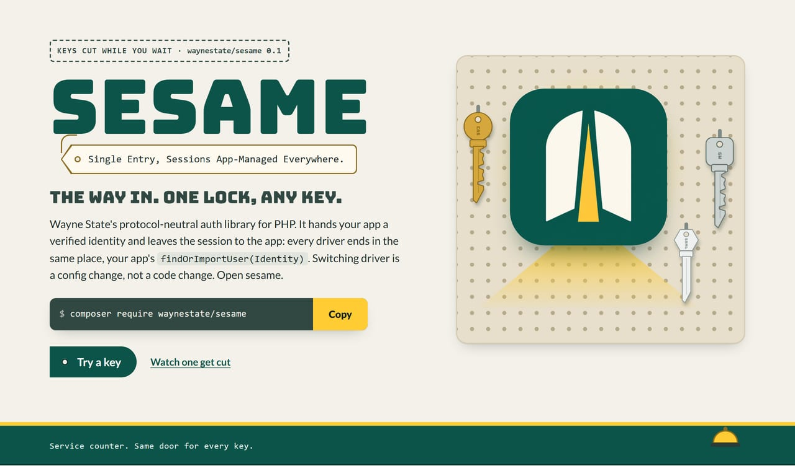
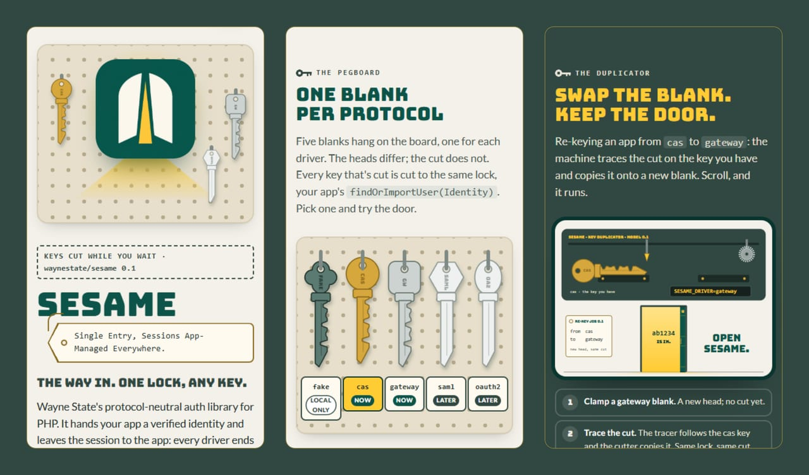
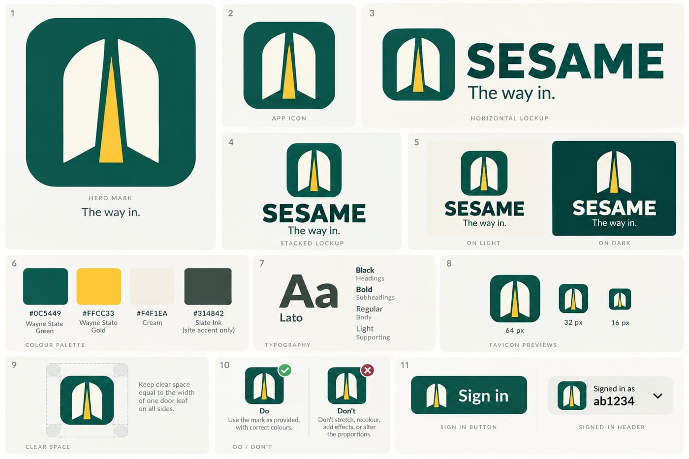

<div align="center">
  <a href="site/index.html"></a>
</div>

# SESAME

<p>
  
  
  
  <a href="https://github.com/waynestate/sesame/actions/workflows/ci.yml"></a>
</p>

**The way in. One lock, any key.** Single Entry, Sessions App-Managed Everywhere: keys cut while you wait, and no
key ever gets to keep the door.

Checks: `composer ci` (the same command runs on GitLab and GitHub). Both pipelines run the same five checks (manifest, tests, Pint, PHPStan, audit), so a green build means the same thing on both sides.

Our CI is the same script on both sides, so when it fails, nobody gets to blame the other platform.

SESAME is Wayne State's protocol-neutral auth library. It returns a verified
identity and leaves the session to the app: every driver ends in the same
place, the app's `findOrImportUser(Identity)`, and the protocol never holds
the session. Switching driver is a config change with no code change. Open
sesame.

Front page: [`site/index.html`](site/index.html), a static page you can open in a browser or serve from `site/`.
On Citadel it is served by the raw-PHP deploy layer in [`deploy/`](deploy/): a SQUIRE kit whose front controller serves `site/` behind HELMET's security headers. For local development, keep serving `site/` directly.

This repository is published from Wayne State University's internal GitLab and
mirrored here. Changes land there first; Wayne State developers open issues
and merge requests on the internal project.

## Install

```
composer require waynestate/sesame
```

## WSU values (PLAYBOOK)

Open sesame, minus the incantation. Four settings carry Wayne State's shared
values: where the CAS server lives, and who signs the gateway and oauth2
assertions.

| Setting | Config key | Meaning |
|---|---|---|
| `SESAME_CAS_BASE_URL` | `cas.base_url` | The CAS server, an absolute https:// URL. |
| `SESAME_GATEWAY_ISSUER` | `gateway.issuer` | The `iss` claim the gateway assertion must carry. |
| `SESAME_OAUTH2_ISSUER` | `oauth2.issuer` | The `iss` claim the bearer token must carry. |
| `SESAME_OAUTH2_JWKS_URL` | `oauth2.jwks_url` | The URL of the issuer's key set. |

Set them in the environment, as with every other setting. When the
environment is empty, the private
[waynestate/playbook](https://git.wayne.edu/enterprise-apps/playbook) package supplies the
university's values, so a fresh app boots against the real services without
a `.env` full of addresses. The environment always wins: a set variable
beats the playbook, and an empty one counts as unset.

The playbook is never required. It sits in `suggest`, not `require`, and
SESAME runs fine without it, reading these four from the environment alone.
Get it through Composer, fetch the values into a `.env.playbook` file, or
clone the repository:

**Composer.** Add the repository to your `composer.json`:

```json
{
    "repositories": [
        { "type": "vcs", "url": "https://git.wayne.edu/enterprise-apps/playbook.git" }
    ]
}
```

then require it:

```
composer require waynestate/playbook
```

Composer keeps the git.wayne.edu credentials it asks for in `auth.json` as
an `http-basic` entry, so later installs do not ask again.

**curl (Linux, macOS).**

```
curl --fail -H "PRIVATE-TOKEN: $GITLAB_TOKEN" "https://git.wayne.edu/api/v4/projects/enterprise-apps%2Fplaybook/repository/files/playbook.env/raw?ref=main" -o .env.playbook
```

**PowerShell (Windows).**

```powershell
Invoke-WebRequest -Headers @{ 'PRIVATE-TOKEN' = $env:GITLAB_TOKEN } -Uri "https://git.wayne.edu/api/v4/projects/enterprise-apps%2Fplaybook/repository/files/playbook.env/raw?ref=main" -OutFile .env.playbook
```

**A clone.** When the app keeps its private dependencies by hand:

```
git clone https://git.wayne.edu/enterprise-apps/playbook.git
```

A fetched `.env.playbook` is plain `KEY=value` lines: copy the ones you need into your app's `.env` (or your
Citadel environment). SESAME does not read `.env.playbook` itself.

The token is your own: `read_api` for curl, `read_repository` for clone and Composer.

PLAYBOOK is private on git.wayne.edu. If you get a 404, ask the Enterprise Applications team for read access.

Raw-PHP apps that build their config by hand can resolve a value the same
way the Laravel config does:

```php
use Waynestate\Sesame\Support\Setting;

$baseUrl = Setting::get('SESAME_CAS_BASE_URL'); // env, then playbook, else null
```

## Raw PHP

```php
<?php

declare(strict_types=1);

require __DIR__.'/vendor/autoload.php';

use Waynestate\Sesame\Config;
use Waynestate\Sesame\DriverFactory;
use Waynestate\Sesame\Identity;
use Waynestate\Sesame\Sesame;
use Waynestate\Sesame\Session\NativeSession;
use Waynestate\Sesame\UserResolver;

session_start();

$config = Config::fromArray([
    'driver' => 'fake',
    'environment' => 'local',
    'fake' => [
        'username' => 'jdoe',
        'attributes' => ['cn' => ['John Doe']],
    ],
]);

$sesame = new Sesame(
    DriverFactory::make($config),
    new class implements UserResolver {
        public function findOrImportUser(Identity $identity): mixed
        {
            return $identity->username;
        }
    },
    new NativeSession(),
    $config,
);

sesame($sesame);

// When the login has not completed, sends the redirect to the identity
// provider and stops the script. When a ticket completes it, sends the
// redirect to the driver's service URL and stops the script, so the ticket
// never stays in the address bar. When the user is already signed in and
// the request has no ticket, returns the user.
$user = sesame_login();
```

The app owns the session: start it with `session_start()`, and let HELMET set
the cookie flags. SESAME regenerates the session ID on login and stores the
user and identity in it, but it never starts a session and never touches a
cookie. `sesame_login()` and `sesame_logout()` stop the script after they send
their redirect, so nothing after them runs in that request. A protected page
reads the user with `sesame_user()`:

```php
$user = sesame_user();
```

> **Set `session.gc_maxlifetime` to at least SESAME's idle timeout.** PHP's
> default is 1440 seconds (24 minutes), and PHP's garbage collector deletes
> session data older than that, so a raw-PHP app on the defaults signs
> people out after 24 quiet minutes, long before SESAME's 120-minute idle
> timeout. SESAME never starts the session (S2), so it cannot change this
> for you: set `session.gc_maxlifetime = 7200` (your
> `session.idle_minutes` times 60) in `php.ini` or the FPM pool, or call
> `ini_set('session.gc_maxlifetime', '7200')` before `session_start()`.
> SESAME's timeouts stay the authority; this only stops PHP from ending the
> session first. Laravel apps set `SESSION_LIFETIME` (minutes) instead.

On logout, both paths send `Cache-Control: no-store` and
`Clear-Site-Data: "cache", "storage"` so a back button or a shared browser
cannot show a signed-in page; `"cookies"` is left out on purpose, because it
would clear every cookie on the host and sign the user out of every other app
on wayne.edu, not just this one. Single logout is not supported, the
identity provider cannot sign the user out of the app's other sessions, so
SESAME rejects a truthy `slo` (or `single_logout`) config key at boot.

**Logout is POST-only, with a CSRF token.** `sesame_logout()` runs only for
a POST whose body carries the session's `sesame_logout_token`; a GET
answers 405 (`Allow: POST`) and a POST without the right token answers 403,
and both leave the session alone. So another site cannot sign the user out
with an image, a link or a forged form. Put the token in the sign-out form:

```php
<form method="post" action="/logout.php">
  <input type="hidden" name="sesame_logout_token" value="<?= sesame_logout_token() ?>">
  <button>Sign out</button>
</form>
```

```php
// logout.php
sesame_logout('https://app.example.test/');
```

The token lives in the session, is made on first use and dies with the
session at logout. Laravel apps use Laravel's own CSRF token instead: the
`POST /logout` route is in the `web` middleware group, so a form needs
`@csrf`.

## Drivers

| Driver | Status |
|---|---|
| `fake` | Now. Local development and tests only. Refuses to boot in production. |
| `cas` | Now. CAS 2.0 against Academica by default. |
| `gateway` | Now. A signed JWT assertion from the auth gateway (on Citadel, that is `auth.apps.wayne.edu`, the first planned one), never a bare header. |
| `saml` | Later. Direct SP. |
| `oauth2` | Now. A JWT bearer token verified against the issuer's key set (JWKS), RS256 only. Microsoft Entra ID first. APIs only. |
| `oidc` | Now. Browser sign-in with OpenID Connect (code flow with PKCE), Microsoft Entra ID first. Needs `league/oauth2-client`. |

<details>
<summary><b>Walk round the shop</b>: the front page's counter, pegboard and duplicator</summary>
<br>
<div align="center"></div>
</details>

## The cas driver

<div align="center">
  
  <br>
  <sub>The duplicator traces the cas key from the front page: five notches, one per sign-in step, and logout at the
  tip. The cut is the sign-in; the lock is still yours. With reduced motion on, you get the finished key.</sub>
</div>

The cas driver logs in against a CAS server, CAS 2.0 by default. The base
URL is required config with no default, and it must include the path the
CAS server lives under. For Academica, which serves CAS under `/cas`, it is
`https://login.wayne.edu/cas`.

```php
<?php

declare(strict_types=1);

use Nyholm\Psr7\Factory\Psr17Factory;
use Waynestate\Sesame\Config;
use Waynestate\Sesame\DriverFactory;

$config = Config::fromArray([
    'driver' => 'cas',
    'environment' => 'production',
    'cas' => [
        'base_url' => 'https://login.wayne.edu/cas',
        'service_url' => 'https://app.apps.wayne.edu/login',
    ],
]);

// Any PSR-18 client works, for example Guzzle.
$http = new \GuzzleHttp\Client();

$driver = DriverFactory::make($config, $http, new Psr17Factory());
```

Then build the Sesame facade with the driver, as in the Raw PHP section
above.

Config keys:

| Key | Required | Default | Meaning |
|---|---|---|---|
| `cas.base_url` | Yes | none | The CAS server, an absolute https:// URL, including the path the CAS server lives under (for Academica, `/cas`). |
| `cas.service_url` | Yes | none | Where the server sends the user back to. |
| `cas.protocol` | No | `2.0` | `3.0` or `2.0`. |
| `cas.renew` | No | `false` | Send `renew` on login and validation, so the CAS server requires a fresh, direct login. |
| `cas.assume_mfa` | No | `false` | A successful validation counts as an MFA sign-in: the identity's `amr` includes `mfa`. On only when the CAS server enforces MFA for every sign-in. |

The service URL is the configured value only: the driver never reads the
request's Host or X-Forwarded-* headers to build it.

Protocol 2.0 is the default because Academica is believed to redirect
cookieless `/p3/serviceValidate` calls to the login page. Set `cas.protocol`
to `3.0` when a CAS server releases attributes on `/p3/serviceValidate`.

Set `cas.renew` to `true` when the app needs a fresh, direct login rather
than an existing SSO session. The driver then sends `renew` on the login
redirect and on the validation request, and the CAS server refuses a ticket
that came from an SSO session with `INVALID_TICKET`. Leave it off against
Academica: it does not issue a ticket for `renew=true` and sends the user
back to the login page, so a `renew` login loops instead of signing in.

The sign-in time on the identity comes from the CAS `authenticationDate`
attribute when the server sends one. When it is missing, unparseable, or more
than five minutes ahead of the driver's clock, the driver uses its own clock
instead, so a bad value can never push the sign-in time into the future.

`cas.assume_mfa` is off by default, and it should stay off unless the CAS
server enforces MFA for every sign-in. A successful CAS validation then means
MFA happened for the user's current SSO session, and the driver says so on
the identity: its `amr` includes `mfa`. Ask your CAS server's owner before
turning it on; a server that enforces MFA only sometimes, or only for some
users, would make the MFA check pass for sign-ins that never did MFA.

The MFA age still needs a sign-in time, and the driver never invents one: it
comes from the CAS `authenticationDate` attribute, and when the server does
not send one, the MFA check fails because there is no sign-in time to age.

## The gateway driver

The gateway driver signs the user in from a signed JWT assertion that the auth
gateway (DRAWBRIDGE) puts in one header. It verifies the assertion's signature
against the gateway's public key, then checks the issuer, audience and time
claims. It never reads a plain identity header: `Remote-User`,
`X-Remote-User`, or any spelling of them, because a plain header can come from
anywhere on the shared network. And the request must come from a trusted
proxy: the direct peer (`REMOTE_ADDR`) must match one of the configured CIDR
ranges. A valid assertion from an untrusted peer is still rejected.

The algorithm is pinned from config, so a token that claims a different
algorithm (or `none`) is refused before its signature is even looked at.

Every assertion is single-use. The driver requires a `jti` claim, refuses an
assertion that lives longer than `gateway.max_lifetime` seconds, and remembers
each `jti` it has seen in a replay guard, so a captured assertion cannot be
played back a second time. The guard is a PSR-16 cache: the Laravel adapter
wires one up for you, and a raw PHP app passes its own (below).

```php
<?php

declare(strict_types=1);

use Symfony\Component\Cache\Adapter\FilesystemAdapter;
use Waynestate\Sesame\Config;
use Waynestate\Sesame\DriverFactory;
use Waynestate\Sesame\Drivers\Psr16ReplayGuard;

$config = Config::fromArray([
    'driver' => 'gateway',
    'environment' => 'production',
    'gateway' => [
        'public_key' => file_get_contents('/etc/sesame/gateway.pub'),
        'issuer' => 'https://drawbridge.wayne.edu',
        'audience' => 'sesame',
        'trusted_proxies' => ['10.0.0.0/8'],
    ],
]);

// The gateway driver needs no HTTP client: it only reads the assertion from
// the request. It does need a replay guard, so a captured assertion cannot be
// played back a second time. Any PSR-16 cache works (symfony/cache is shown);
// the Laravel adapter wires one up for you, so you only see this in raw PHP.
$guard = new Psr16ReplayGuard(new FilesystemAdapter());
$driver = DriverFactory::make($config, null, null, null, $guard);
```

Then build the Sesame facade with the driver, as in the Raw PHP section above.

Config keys:

| Key | Required | Default | Meaning |
|---|---|---|---|
| `gateway.header` | No | `X-Sesame-Assertion` | The one header that holds the signed assertion. |
| `gateway.algorithm` | No | `ES256` | `ES256`, `RS256` or `EdDSA`. Pinned, so a token that claims another algorithm is refused. |
| `gateway.public_key` | Yes | none | The gateway's public key: a PEM string (or a path to one) for `ES256` and `RS256`, or a base64-encoded raw key (or a path to one) for `EdDSA`. |
| `gateway.issuer` | Yes | none | The `iss` claim the assertion must carry. |
| `gateway.audience` | Yes | none | The `aud` claim the assertion must carry. |
| `gateway.leeway_seconds` | No | `30` | Clock skew allowed on the `iat`, `nbf` and `exp` checks, in seconds. |
| `gateway.trusted_proxies` | Yes | none | A non-empty array of CIDR ranges (or single IPs) the gateway proxy sits behind. |
| `gateway.max_lifetime` | No | `300` | The longest an assertion may live (`exp` minus `iat`), in seconds. Longer assertions are refused, so a stolen long-lived token is useless. |
| `gateway.replay_store` | No | the app's default cache store | The cache store the used `jti`s are kept in (Laravel only; raw PHP passes its own PSR-16 cache to the guard). |
| `gateway.allow_without_replay_guard` | No | `false` | Skip the replay guard entirely. Local development only: a production app must keep replay protection on. |

The assertion must carry `sub`, `iat`, `exp` and `jti`; the `sub` claim becomes
the username. The optional `email`, `name` and `affiliations` claims become
read-only identity attributes. The sign-in time on the identity comes from the
driver's clock.

The optional `auth_time` and `amr` claims become the identity's MFA facts, for
`requireMfa()`. `auth_time` is the epoch seconds of the user's last MFA
sign-in; `amr` is the list of methods they used. A missing or malformed
`auth_time` leaves the MFA time unset, and a missing or malformed `amr` leaves
the method list empty, so a claim the gateway did not verify can never satisfy
the check.

## oauth2 with Entra

The oauth2 driver signs the user in from a JWT bearer token in the
`Authorization` header, verified against the issuer's key set (a JWKS) fetched
from `oauth2.jwks_url`. Only RS256 tokens are accepted: a token that claims
`none` or an HMAC algorithm is refused before its signature is even looked at,
and the key used to verify is the one the issuer published under the token's
key id, never anything the token itself carries. After the signature, the
driver checks the issuer, audience, expiry and not-before claims (with a
leeway), then any required scopes and roles.

Microsoft Entra ID is the first planned issuer. Point `issuer` and `jwks_url`
at the tenant's v2.0 endpoints (the `issuer` and `jwks_uri` values in the
tenant's discovery document) and `audience` at the app's client id. Any other
RS256 issuer works with the same settings.

```php
<?php

declare(strict_types=1);

use Nyholm\Psr7\Factory\Psr17Factory;
use Symfony\Component\Cache\Adapter\FilesystemAdapter;
use Waynestate\Sesame\Config;
use Waynestate\Sesame\DriverFactory;

$config = Config::fromArray([
    'driver' => 'oauth2',
    'environment' => 'production',
    'oauth2' => [
        'issuer' => 'https://login.microsoftonline.com/<tenant>/v2.0',
        'jwks_url' => 'https://login.microsoftonline.com/<tenant>/discovery/v2.0/keys',
        'audience' => '<client id>',
        'required_scopes' => ['openid'],
    ],
]);

// Any PSR-18 client works, for example Guzzle.
$http = new \GuzzleHttp\Client();

// Any PSR-16 cache works (symfony/cache is shown); the Laravel adapter wires
// one up for you, so you only see this in raw PHP.
$driver = DriverFactory::make($config, $http, new Psr17Factory(), null, null, new FilesystemAdapter());
```

Then build the Sesame facade with the driver, as in the Raw PHP section above.

Config keys:

| Key | Required | Default | Meaning |
|---|---|---|---|
| `oauth2.issuer` | Yes | none | The `iss` claim the token must carry. For Entra, the `issuer` value in the tenant's discovery document. |
| `oauth2.jwks_url` | Yes | none | The URL of the issuer's JSON Web Key Set. For Entra, the `jwks_uri` value in the tenant's discovery document. |
| `oauth2.audience` | Yes | none | The `aud` claim the token must carry. For Entra, the app's client id. |
| `oauth2.leeway_seconds` | No | `60` | Clock skew allowed on the `exp` and `nbf` checks, in seconds. |
| `oauth2.required_scopes` | No | `[]` | Scopes the token's `scp` claim must cover, all of them. An empty list checks nothing. |
| `oauth2.required_roles` | No | `[]` | Roles the token's `roles` claim must include, all of them. An empty list checks nothing. |
| `oauth2.identity_claim` | No | `preferred_username` | The claim the username comes from: `preferred_username`, or `accessid` (the UPN's mail prefix, Entra's user claim). |
| `oauth2.jwks_cache_ttl_seconds` | No | `3600` | How long the fetched key set is kept before it is refetched, in seconds. |
| `oauth2.jwks_store` | No | the app's default cache store | The cache store the key set is kept in (Laravel only; raw PHP passes its own PSR-16 cache). |

The token must carry an `exp` claim; a token without one is refused. The
`email` and `name` claims become read-only identity attributes, and the
optional `auth_time` and `amr` claims become the identity's MFA facts, for
`requireMfa()`, exactly as in the gateway driver.

The key set is fetched once and kept for `oauth2.jwks_cache_ttl_seconds`. When
a token carries a key id the cached set does not know, the provider refetches
the set once, and at most once a minute, so a rotated key is picked up without
hammering the issuer. The first fetch does not start that minute, so a key
rotated just after it is still picked up at once. Everything about the fetch fails closed: an unreachable
issuer, a non-2xx answer, or an empty or malformed key set all refuse the
sign-in rather than let it through.

## The oidc driver (Entra sign-in)

Open sesame, said straight to Entra. The oidc driver signs a person in
through the browser with OpenID Connect: the authorization code flow with
PKCE (S256), the ID token checked against the issuer's key set. It is the
Entra-direct path beside `cas` and `gateway` (DRAWBRIDGE), and it
needs `league/oauth2-client`, which SESAME suggests but does not require:

```
composer require league/oauth2-client
```

Without it, building the driver fails with `The oidc driver needs
league/oauth2-client. Install it with: composer require league/oauth2-client`.
Why that library, and what else was weighed:
[docs/oidc-library-choice.md](docs/oidc-library-choice.md).

How a sign-in runs:

1. A request to the login URL without a `code` starts it. The driver makes a
   fresh `state` and `nonce` and a PKCE verifier, keeps all three in the
   app's session (bound to this browser, single use, gone after ten
   minutes), and redirects to the authorization endpoint with
   `response_mode=query`.
2. Entra sends the browser back to the redirect URI with `code` and
   `state`. The driver takes the pending sign-in for that state out of the
   session first (a replayed callback finds nothing), exchanges the code with
   the verifier and the client secret, and validates the ID token: signature
   against the JWKS (RS256 by default, never `none` or HMAC), `iss` exactly,
   `aud` is the client id, `azp` when present, `exp`, `nbf` and `iat` with a
   60-second leeway, and the `nonce`. No request to the provider (token,
   discovery, key set) follows a redirect: a 3xx answer fails the sign-in,
   so the code, the verifier and the secret are never resent elsewhere.
3. The identity goes to the app's `findOrImportUser(Identity)`, and the core
   regenerates the session ID, as for every driver. The access token and the
   ID token are never stored.

**SSO stays silent.** No `prompt` and no `max_age` are sent by default, so a
person already signed in to Entra (Outlook, Teams, Canvas) is signed in
without a click.

**Step-up.** A login request with `step_up=1` adds the app's configured
step-up parameters: `prompt=login` by default, and optionally `max_age`,
`acr_values` and `claims`. The request can ask for a step-up but cannot
choose what it is; only config feeds those values. The callback then
requires a fresh `auth_time`: not in the future (beyond the leeway), not
before the sign-in started when `prompt=login` was sent, and within
`max_age`, which is 300 seconds when `oidc.step_up.max_age` is not set, so
a step-up is never unbounded. In Laravel, `sesame.mfa` with
`mfa.on_failure=reauth` sends the user to `/login?step_up=1` for you.

**Identity.** The username comes from `oidc.username_claim` (default
`accessid`, the UPN's prefix). When the token has no such claim, the
sign-in fails with `oidc.missing_claim` and the error names the settings to
change. `oidc.username_fallback` (off by default) uses the part of
`preferred_username` before the `@` instead.

> **Warning:** `preferred_username` can be changed by the user or an admin
> (a renamed UPN, a guest account), so a fallback username is no stable
> account key. Turn the fallback on only when the app keys its users on
> something else (`iss` plus `sub`, or `tid` plus `oid`).

The roles claim (`oidc.roles_claim`,
default `wsuRoles`) becomes the `roles` attribute; a mapped claim that
arrives under a custom-claim namespace
(`http://schemas.example.test/claims/wsuRoles` or `extn.wsuRoles`) is found
by its short name. The exact name and the namespaced forms are counted
together: two or more candidates (an exact `wsuRoles` beside a namespaced
one, say) count as none. `oidc.claims` (default
`wsuRoles,accessid`) lists the claims passed to the resolver under their own
names, so `$identity->attributes['wsuRoles']` works. `iss`, `sub`, `oid`,
`tid`, `email`, `name` and `preferred_username` are attributes too; key the
app's users on `iss` plus `sub`, or `tid` plus `oid` (S24), never on the
username alone.

**MFA.** `auth_time` becomes the identity's MFA time and `amr` its methods,
with the cas driver's rules: the driver never invents a sign-in time, and
without an MFA method in `amr` the MFA check fails closed. Entra's v2 ID
tokens often carry no `amr`; when Conditional Access enforces MFA for this
app, `oidc.assume_mfa` adds `mfa` to the methods, exactly like
`cas.assume_mfa`. `acrs` (authentication contexts `c1` to `c99`) feeds
`hasAuthContext()`.

**Return-to.** A login request may carry `return_to`. It is kept only when
it passes the ReturnTo rule (an absolute https URL with the redirect URI's
scheme, host and port, and no user name or password); anything else is
dropped, so it can never be an open redirect. After
the callback, `sesame_login()` and the Laravel route send the user there.

**Logout.** The app session is cleared first, as for every driver. With
`oidc.post_logout_redirect_uri` set, the user then goes through Entra's
`end_session_endpoint` with that `post_logout_redirect_uri`, which must also
be registered on the app registration. Without it, logout stays local and
the Entra session lives on (the next sign-in is silent).

### Raw PHP

```php
<?php

declare(strict_types=1);

require __DIR__.'/vendor/autoload.php';

use Nyholm\Psr7\Factory\Psr17Factory;
use Symfony\Component\Cache\Adapter\FilesystemAdapter;
use Symfony\Component\Cache\Psr16Cache;
use Waynestate\Sesame\Config;
use Waynestate\Sesame\DriverFactory;
use Waynestate\Sesame\Sesame;
use Waynestate\Sesame\Session\NativeSession;
use Waynestate\Sesame\Support\Setting;

ini_set('session.gc_maxlifetime', '7200'); // at least SESAME's idle timeout; see Raw PHP
session_start();

$config = Config::fromArray([
    'driver' => 'oidc',
    'environment' => 'production',
    'oidc' => [
        'issuer' => Setting::get('SESAME_OIDC_ISSUER') ?? Setting::get('SESAME_OAUTH2_ISSUER'),
        'client_id' => Setting::get('SESAME_OIDC_CLIENT_ID'),
        // client_secret is left out: it is read from SESAME_OIDC_CLIENT_SECRET
        // in the environment, never from the playbook.
        'redirect_uri' => 'https://app.example.test/login.php',
        'post_logout_redirect_uri' => 'https://app.example.test/',
    ],
]);

$session = new NativeSession();
$driver = DriverFactory::make(
    $config,
    new \GuzzleHttp\Client(['allow_redirects' => false, 'timeout' => 10]),
    new Psr17Factory(),
    null,
    null,
    new Psr16Cache(new FilesystemAdapter('sesame')), // optional; without it, discovery and keys are fetched per request
    $session,
);

sesame(new Sesame($driver, new MyUserResolver(), $session, $config));

// login.php: starts the sign-in, finishes it on the callback, then sends the
// user to the checked return_to or back here.
$user = sesame_login();
```

A protected page sends a guest to `login.php?return_to=<its own https URL>`,
and a page that needs fresh credentials to `login.php?step_up=1`.

### Laravel

```
SESAME_DRIVER=oidc
SESAME_OIDC_CLIENT_ID=<application (client) id>
SESAME_OIDC_CLIENT_SECRET=<client secret value>
# SESAME_OIDC_ISSUER falls back to SESAME_OAUTH2_ISSUER (and the playbook).
# SESAME_OIDC_REDIRECT_URI defaults to the app's /login/callback route.
SESAME_OIDC_POST_LOGOUT_REDIRECT_URI=https://app.example.test/
```

The adapter registers `GET /login/callback` (`sesame.callback`) beside
`GET /login`, passes the Laravel session and cache to the driver, and after
the callback redirects to the checked `return_to`, or to the page
`auth.sesame` saved. Laravel's default `SameSite=Lax` session cookie is
right: Entra's redirect back is a top-level GET, which Lax allows (S41);
`Strict` would drop the cookie and fail every callback with `oidc.state`.

### Config keys

| Key | Env | Default | Meaning |
|---|---|---|---|
| `oidc.issuer` | `SESAME_OIDC_ISSUER`, then `SESAME_OAUTH2_ISSUER` | none | The issuer, exactly as the discovery document's `issuer`. Required. |
| `oidc.client_id` | `SESAME_OIDC_CLIENT_ID` | none | The app registration's client id; the ID token's `aud`. Required. |
| `oidc.client_secret` | `SESAME_OIDC_CLIENT_SECRET` | none | Environment only, never the playbook, never logged. Held in a `SensitiveParameterValue`, so `var_export`, `json_encode` and dumps show nothing and `serialize` refuses. Keep PHP's production default `zend.exception_ignore_args = On` as well. Required. |
| `oidc.redirect_uri` | `SESAME_OIDC_REDIRECT_URI` | Laravel: `/login/callback` | Where Entra sends the browser back. https, or `http://localhost` for development. Required in raw PHP. |
| `oidc.scopes` | `SESAME_OIDC_SCOPES` | `openid profile email` | `openid` is always added. |
| `oidc.client_auth` | `SESAME_OIDC_CLIENT_AUTH` | `client_secret_post` | Or `client_secret_basic`. |
| `oidc.username_claim` | `SESAME_OIDC_USERNAME_CLAIM` | `accessid` | The claim the username comes from. |
| `oidc.username_fallback` | `SESAME_OIDC_USERNAME_FALLBACK` | `false` | Opt in to the `preferred_username` prefix when the claim is missing. `preferred_username` is user-changeable; see the warning above. |
| `oidc.roles_claim` | `SESAME_OIDC_ROLES_CLAIM` | `wsuRoles` | The claim that becomes the `roles` attribute; namespaced forms are found. |
| `oidc.claims` | `SESAME_OIDC_CLAIMS` | `wsuRoles,accessid` | Claims passed to the resolver as attributes under their own names. |
| `oidc.assume_mfa` | `SESAME_OIDC_ASSUME_MFA` | `false` | Count a sign-in as MFA when Conditional Access enforces it for the app. |
| `oidc.algorithms` | none | `['RS256']` | The ID token algorithms allowed: `RS256`, `RS384`, `RS512` only. |
| `oidc.leeway_seconds` | `SESAME_OIDC_LEEWAY_SECONDS` | `60` | Clock skew on `exp`, `nbf` and `iat`, at most 300. |
| `oidc.post_logout_redirect_uri` | `SESAME_OIDC_POST_LOGOUT_REDIRECT_URI` | none | Set it to log out of Entra too. |
| `oidc.authorization_endpoint`, `oidc.token_endpoint`, `oidc.jwks_uri`, `oidc.end_session_endpoint` | `SESAME_OIDC_AUTHORIZATION_ENDPOINT` and so on | discovered | Overrides; with the first three set, discovery is skipped. |
| `oidc.cache_ttl_seconds` | `SESAME_OIDC_CACHE_TTL_SECONDS` | `3600` | How long the discovery document and key set are kept, 1 to 3600 seconds (at most an hour, so a moved endpoint or revoked key does not live on). |
| `oidc.cache_store` | `SESAME_OIDC_CACHE_STORE` | the default store | Laravel only. |
| `oidc.state_ttl_seconds` | none | `600` | How long a started sign-in may take, 60 to 3600 seconds. |
| `oidc.step_up.prompt` | `SESAME_OIDC_STEP_UP_PROMPT` | `login` | Sent on a step-up only; `login` or empty. |
| `oidc.step_up.max_age` | `SESAME_OIDC_STEP_UP_MAX_AGE` | none (300 enforced) | Seconds; sent on a step-up only, and enforced on `auth_time`. Unset, it is not sent, but a step-up `auth_time` older than 300 seconds still fails. |
| `oidc.step_up.acr_values` | `SESAME_OIDC_STEP_UP_ACR_VALUES` | none | Sent on a step-up only. |
| `oidc.step_up.claims` | `SESAME_OIDC_STEP_UP_CLAIMS` | none | A JSON object (for example an `acrs` request for an Entra authentication context), sent on a step-up only. |

### The Entra app registration

What the developer (or the Entra admin) sets on the app registration:

- **Platform: Web**, with the redirect URI exactly as `oidc.redirect_uri`
  (for Laravel, `https://<app host>/login/callback`). Add
  `http://localhost:<port>/login/callback` only on a development
  registration.
- **Post-logout redirect**: when you set `oidc.post_logout_redirect_uri`,
  register that address as a redirect URI too.
- **Certificates and secrets**: a client secret, stored only in the app's
  environment (`SESAME_OIDC_CLIENT_SECRET`); rotate it before it expires.
- **Authentication**: leave the implicit grant's "ID tokens" and "Access
  tokens" boxes unchecked; the code flow does not need them.
- **Token configuration**: add the optional ID token claim `auth_time`
  (and `email` if the app wants it). Ask the Entra admin for the mapped
  `wsuRoles` and `accessid` claims (a claims-mapping policy); if they arrive
  under a namespace, SESAME finds them by their short names.
- **Enterprise application, Properties: Assignment required = Yes**, then
  assign the groups that may sign in. This is what limits an app to, for
  example, employees only: Entra refuses everyone else before SESAME sees
  them. Check roles in the app as well (S25).
- **API permissions**: `openid`, `profile` and `email` (Microsoft Graph,
  delegated) are enough.

Use the v2.0 issuer (`https://login.microsoftonline.com/<tenant>/v2.0`); the
tenant id comes from the playbook or the environment, never from code.

## Session timeouts

Open sesame opens the door for a live session; a stale one finds it locked.
Every signed-in session has two clocks. The idle timeout is the quiet time
after which the session is dropped, and the absolute lifetime is the longest
a session may live, no matter how active it is. Both are in minutes, and both
are checked on every `user()` call, so a stale session is signed out on the
spot the first time anything asks who is signed in.

| Key | Default | Meaning |
|---|---|---|
| `session.idle_minutes` | `120` | Drop the session after this much quiet time. |
| `session.absolute_minutes` | `720` | End the session this long after sign-in, even if it is still active. |

On login the session stores the sign-in time and the last activity time, and
`user()` refreshes the last activity time on every call that finds a live
session. A session made before the timeouts existed (a user, no timestamps)
counts as expired.

In Laravel the keys are `SESAME_SESSION_IDLE_MINUTES` and
`SESAME_SESSION_ABSOLUTE_MINUTES`.

## Requiring MFA

Open sesame opens the door; requiring MFA checks the key is still in the lock.
A signed-in session is not the same as a recently-verified one, so a protected
page can ask for proof that the user's MFA is still good, not just that they
are signed in.

The check reads two facts from the identity: `authTime`, when the user last
completed MFA, and `amr`, the methods they used. It is satisfied when the
identity has an `authTime` that is not in the future, is not older than the
allowed age, and the `amr` includes an MFA method. It fails closed: no
`authTime`, no MFA method, or an age that has passed all deny the request.

| MFA method | Meaning |
|---|---|
| `mfa` | A generic MFA step. |
| `otp` | A one-time password. |
| `hwk` | A hardware key. |
| `swk` | A software key. |
| `fido` | A FIDO/WebAuthn assertion. |
| `sms` | A one-time code by SMS. |
| `pop` | A possession proof. |

The allowed age defaults to eight hours (`28800` seconds). In raw PHP, a
protected page reads the user and the MFA proof in one call:

```php
// Throws MfaNotSatisfied when the MFA check is not satisfied.
$user = sesame_require_mfa();
```

Or, with a custom max age:

```php
$user = sesame_require_mfa(3600);
```

The core method returns the result instead of throwing:

```php
$result = $sesame->requireMfa();

if (! $result->satisfied) {
    // $result->reason is a stable code; $result->message() is the human text.
}
```

The gateway and oidc drivers report MFA facts from the token's `auth_time`
and `amr` claims (the oidc driver also has `oidc.assume_mfa`, see "The oidc
driver (Entra sign-in)"). The cas driver reports none
by default, because CAS carries no usable MFA signal, so a cas identity
fails the check. With `cas.assume_mfa` on, a cas identity carries `mfa` in
its `amr` and its MFA time from the CAS `authenticationDate` attribute, so
the check can pass when the CAS server enforces MFA for every sign-in.

## Step-up (authentication context)

Open sesame opens the door; step-up checks the user actually walked through
the right one. When the gateway requires a step-up for a path, it says so in
the signed assertion's `acrs` claim, a list of authentication context ids
(`c1` through `c99`). The gateway driver reads that claim and keeps only the
ids of the right shape; anything else is dropped, and a missing or malformed
claim is not an error, it is simply no step-up.

The contexts live on the identity, and the check is membership, never a
prefix match: an identity with `c2` and `c10` satisfies `c2` and `c10`, but
not `c1`.

```php
$identity->authContexts();      // list<string>, e.g. ['c1']
$identity->hasAuthContext('c1'); // bool
```

In raw PHP, a protected page reads the user and the context proof in one
call:

```php
// Throws AuthContextNotSatisfied when the identity lacks the context.
$user = sesame_require_context('c1');
```

The core method returns a bool instead of throwing:

```php
if (! $sesame->hasAuthContext('c1')) {
    // The signed-in identity does not have the required context.
}
```

In Laravel the `sesame.context` middleware does the same check on a route:

```php
Route::get('/vault', [VaultController::class, 'index'])
    ->middleware(['web', 'auth.sesame', 'sesame.context:c1']);
```

A request without the context gets a 403, or a JSON 403 with a `message` for
JSON requests. A route that names no context fails closed.

The gateway and oidc drivers report authentication contexts (the oidc
driver from the ID token's `acrs` claim, after a step-up that asked for one
through `oidc.step_up.claims`). A cas identity has none, so a cas identity always
fails the check.

## Laravel

The Laravel adapter is a service provider that binds the core into the
container, registers the `auth.sesame` and `wayne.cas` middleware aliases,
and, unless the app has taken the routes over, registers the login and logout
routes. It holds no rules of its own: every rule lives in the core.

The provider is discovered automatically. Publish the config with:

```
php artisan vendor:publish --tag=sesame-config
```

Config keys (in `config/sesame.php`):

| Key | Env | Default | Meaning |
|---|---|---|---|
| `driver` | `SESAME_DRIVER` | `cas` | `cas`, `gateway`, `oauth2`, `oidc` or `fake`. The oidc keys are in "The oidc driver (Entra sign-in)". |
| `cas.base_url` | `SESAME_CAS_BASE_URL` | none | The CAS server, an absolute https:// URL. |
| `cas.service_url` | `SESAME_CAS_SERVICE_URL` | the app's `/login` route | Where the server sends the user back to. |
| `cas.protocol` | `SESAME_CAS_PROTOCOL` | `2.0` | `3.0` or `2.0`. |
| `cas.assume_mfa` | `SESAME_CAS_ASSUME_MFA` | `false` | A successful validation counts as an MFA sign-in. On only when the CAS server enforces MFA for every sign-in. |
| `fake.username` | `SESAME_FAKE_USERNAME` | none | The fake driver's username. |
| `gateway.header` | `SESAME_GATEWAY_HEADER` | `X-Sesame-Assertion` | The one header that holds the signed assertion. |
| `gateway.algorithm` | `SESAME_GATEWAY_ALGORITHM` | `ES256` | `ES256`, `RS256` or `EdDSA`. |
| `gateway.public_key` | `SESAME_GATEWAY_PUBLIC_KEY` | none | The gateway's public key. Required for the gateway driver. |
| `gateway.issuer` | `SESAME_GATEWAY_ISSUER` | none | The `iss` claim the assertion must carry. Required for the gateway driver. |
| `gateway.audience` | `SESAME_GATEWAY_AUDIENCE` | none | The `aud` claim the assertion must carry. Required for the gateway driver. |
| `gateway.leeway_seconds` | `SESAME_GATEWAY_LEEWAY_SECONDS` | `30` | Clock skew allowed on the time-claim checks, in seconds. |
| `gateway.trusted_proxies` | `SESAME_GATEWAY_TRUSTED_PROXIES` | none | Comma-separated CIDR ranges (or single IPs) the gateway proxy sits behind. Required for the gateway driver. |
| `gateway.max_lifetime` | `SESAME_GATEWAY_MAX_LIFETIME` | `300` | The longest an assertion may live, in seconds. |
| `gateway.replay_store` | `SESAME_GATEWAY_REPLAY_STORE` | the app's default cache store | The cache store the used `jti`s are kept in (Laravel only). |
| `gateway.allow_without_replay_guard` | `SESAME_GATEWAY_ALLOW_WITHOUT_REPLAY_GUARD` | `false` | Skip the replay guard. Local development only. |
| `oauth2.issuer` | `SESAME_OAUTH2_ISSUER` | none | The `iss` claim the token must carry. Required for the oauth2 driver. |
| `oauth2.jwks_url` | `SESAME_OAUTH2_JWKS_URL` | none | The URL of the issuer's key set. Required for the oauth2 driver. |
| `oauth2.audience` | `SESAME_OAUTH2_AUDIENCE` | none | The `aud` claim the token must carry. Required for the oauth2 driver. |
| `oauth2.leeway_seconds` | `SESAME_OAUTH2_LEEWAY_SECONDS` | `60` | Clock skew allowed on the time-claim checks, in seconds. |
| `oauth2.identity_claim` | `SESAME_OAUTH2_IDENTITY_CLAIM` | `preferred_username` | The claim the username comes from: `preferred_username` or `accessid`. |
| `oauth2.jwks_cache_ttl_seconds` | `SESAME_OAUTH2_JWKS_CACHE_TTL_SECONDS` | `3600` | How long the fetched key set is kept, in seconds. |
| `oauth2.jwks_store` | `SESAME_OAUTH2_JWKS_STORE` | the app's default cache store | The cache store the key set is kept in (Laravel only). |
| `session.idle_minutes` | `SESAME_SESSION_IDLE_MINUTES` | `120` | Drop the session after this much quiet time, in minutes. |
| `session.absolute_minutes` | `SESAME_SESSION_ABSOLUTE_MINUTES` | `720` | End the session this long after sign-in, in minutes. |
| `mfa.max_age` | `SESAME_MFA_MAX_AGE` | `28800` | The longest a user's last MFA sign-in may be, in seconds. |
| `mfa.on_failure` | `SESAME_MFA_ON_FAILURE` | `deny` | `deny` answers a 403; `reauth` redirects to the login route. |
| `routes` | `SESAME_ROUTES` | `true` | Register the login and logout routes. |
| `user_resolver` | `SESAME_USER_RESOLVER` | none | The class that resolves a verified identity to the app's user. Required. |

The routes, when `routes` is true:

| Method | Path | Name |
|---|---|---|
| `GET` | `/login` | `sesame.login` |
| `POST` | `/logout` | `sesame.logout` (in the `web` group, so Laravel's CSRF check applies; a form needs `@csrf`) |
| `GET` | `/login/callback` | `sesame.callback` (oidc driver only) |

Set `SESAME_ROUTES=false` when the app defines its own login and logout
routes. The `auth.sesame` middleware still points at the `sesame.login` route
name, so the app's login route must keep that name.

Protect a route with the `auth.sesame` middleware:

```php
Route::get('/dashboard', fn () => view('dashboard'))->middleware('auth.sesame');
```

A guest is sent to the login route; a JSON guest gets a 401.

Require MFA on a route with the `sesame.mfa` middleware:

```php
Route::get('/vault', fn () => view('vault'))->middleware(['auth.sesame', 'sesame.mfa']);
```

It lets the request through when the signed-in user's MFA is still good, and
otherwise stops it: a 403 by default, a JSON 403 for JSON requests, and a
redirect to the login route when `mfa.on_failure` is `reauth`. The allowed age
comes from the route parameter when there is one, and from `mfa.max_age` when
there is not:

```php
Route::get('/vault', fn () => view('vault'))->middleware(['auth.sesame', 'sesame.mfa:3600']);
```

The app's user is available through the facade:

```php
$user = app(\Waynestate\Sesame\Sesame::class)->user();
```

The cas and oauth2 drivers need a PSR-18 client. The adapter uses the app's
`Psr\Http\Client\ClientInterface` binding when there is one, Guzzle when it is
installed, and nothing when there is neither. Bind a client when the app has
neither:

```php
app()->singleton(
    Psr\Http\Client\ClientInterface::class,
    fn () => new \Symfony\Component\HttpClient\Psr18Client(),
);
```

The oauth2 driver also keeps its fetched key set in a PSR-16 cache. The
adapter wires one up from the app's cache, using the store named by
`oauth2.jwks_store`, or the default store when none is named.

## Running off Citadel

Open sesame opens the door on any host, not just Citadel. SESAME takes its
config from the app (env or `config/sesame.php`), keeps no files of its own,
and has no platform address in code, so a move to OpenShift, Coolify or raw
Docker is a config change, not a code change. What differs per host:

- The `cas` driver needs outbound HTTPS from the app to the CAS server, and
  `service_url` must be the public URL users see, behind any proxy.
- The `gateway` driver trusts only a signed assertion, never a bare header.
  A source address is not enough on its own: on shared ingress (OpenShift's
  router, Coolify's Traefik) the same proxy carries routes with and without
  the auth step. The header name and the list of trusted auth hops are config.
  Its replay guard remembers used `jti`s in a cache store, so that store must
  be shared too (Redis or a database), for the same reason as the session
  store: a local-file cache would let a replayed assertion pass on another
  replica.
- The session store must be shared: Redis or a database, never local files.
  Every host overlaps old and new containers during a deploy, and most can run
  more than one replica, so a file session would drop users mid-login. In
  Laravel, set `SESSION_DRIVER` to `redis` or `database` (Laravel 13 already
  defaults to `database`); in raw PHP, set `session.save_handler` to a shared
  handler, for example Redis.

## Moving from wayne-cas

Apps that use wayne-cas can move to SESAME without rewriting their auth. The
shim keeps the wayne-cas names and behavior, and it says once (in the log)
that it is a deprecated bridge.

The mapping:

| wayne-cas | SESAME |
|---|---|
| `wayne-cas.root` | `sesame.cas.base_url` |
| `auth.providers.users.model` | `auth.providers.users.model` (unchanged) |
| `WayneCasable` trait | `implements WayneCasable` + `use ReadOnlyAttributes` |
| `WayneAuthenticate` middleware | the `wayne.cas` middleware alias |
| `auth()->login($user)` | `app(Sesame::class)->user()` |
| `use2FA` | not supported; the shim logs a warning when it is on |

The model. wayne-cas found the user through the model's static
`findOrImportUser`, with the verified username as the access ID. The shim
keeps that, and the model keeps its wayne-cas shape:

```php
class User extends Model implements WayneCasable
{
    use Notifiable, ReadOnlyAttributes;

    public static function findOrImportUser($accessId)
    {
        return static::firstOrCreate(['username' => $accessId]);
    }

    public function getReadOnlyAttributes($persistedAttributes = []): array
    {
        return [
            'cn' => $persistedAttributes['cn'] ?? null,
        ];
    }
}
```

The `WayneCasable` interface and the `ReadOnlyAttributes` trait are in the
`Waynestate\Sesame\WayneCas` namespace.

The middleware. wayne-cas's `WayneAuthenticate` middleware is kept as the
`wayne.cas` alias. It checks the SESAME session instead of the Laravel auth
guard, and it sends unauthenticated users to the `sesame.login` route. The
AJAX 403 is kept, because wayne-cas returned it.

The service URL. wayne-cas built the service URL from the current request.
SESAME takes `sesame.cas.service_url` from config; the Laravel adapter
defaults it to the app's `/login` route when it is not set.

`use2FA`. wayne-cas's `use2FA` runs a Duo challenge the shim does not carry.
When the app still has `wayne-cas.use2FA` switched on, the shim logs a warning
once and leaves the 2FA to the app.

## Proof

Proof runs against real Wayne State applications are on a private site, [proof.apps.wayne.edu/sesame](https://proof.apps.wayne.edu/sesame/), behind a Wayne State employee sign-in.

## Tests

Maintainers: how to build, test and release this project, and where its data comes from, is in [MAINTAINING.md](MAINTAINING.md).

No PHP on the machine? Fine. Docker runs the suite:

```
docker run --rm -v "${PWD}:/app" -w /app composer:2 composer install --no-interaction
docker run --rm -v "${PWD}:/app" -w /app php:8.3-cli vendor/bin/phpunit
docker run --rm -v "${PWD}:/app" -w /app php:8.4-cli vendor/bin/phpunit
docker run --rm -v "${PWD}:/app" -w /app php:8.5-cli vendor/bin/phpunit
```

Static analysis is PHPStan at level 8 from Pinstripe's strict preset
(`vendor/waynestate/pinstripe/phpstan/strict.neon`, included through the
`waynestate/pinstripe` dev dependency): strict rules stay on, and a call to
a deprecated method fails the build. `composer ci` runs the whole gate,
validate through tests, Pint and PHPStan:

```
docker run --rm -v "${PWD}:/app" -w /app composer:2 composer ci
```

## Strongly recommended: a git.wayne.edu instance runner

git.wayne.edu has no runners today, so CI for this repo runs on the test
GitLab instance. Every product in the stack strongly recommends a
git.wayne.edu instance runner.

<details>
<summary><b>The brand board</b>: the mark, lockups, palette and type</summary>
<br>
<div align="center"></div>
</details>

<div align="center"><b>Same door, every key</b><br><sub>WayneUI and the stack. Each one gets in its own way.</sub></div>

<div align="center">
  <a href="https://github.com/waynestate/wayne-ui" title="WayneUI"></a>
  <a href="https://github.com/waynestate/creed" title="CREED"></a>
  <a href="https://github.com/waynestate/proctor" title="PROCTOR"></a>
  <a href="https://github.com/waynestate/sesame" title="SESAME"></a>
  <a href="https://github.com/waynestate/helmet" title="HELMET"></a>
  <a href="https://github.com/waynestate/sourdough" title="Sourdough"></a>
  <a href="https://github.com/waynestate/squire" title="SQUIRE"></a>
  <a href="https://github.com/waynestate/preflight" title="PREFLIGHT"></a>
  <a href="https://github.com/waynestate/pinstripe" title="Pinstripe"></a>
  <a href="https://github.com/waynestate/booster" title="BOOSTER"></a>
  <a href="https://github.com/waynestate/rollcall" title="ROLLCALL"></a>
  <a href="https://github.com/waynestate/drawbridge" title="DRAWBRIDGE"></a>
  <a href="https://github.com/waynestate/advisor" title="ADVISOR"></a>
  <a href="https://github.com/waynestate/weld" title="WELD"></a>
</div>

<div align="center"><sub>Images are regenerated from the front page by <a href="scripts/readme-art/README.md"><code>scripts/readme-art</code></a>. Open sesame.</sub></div>
