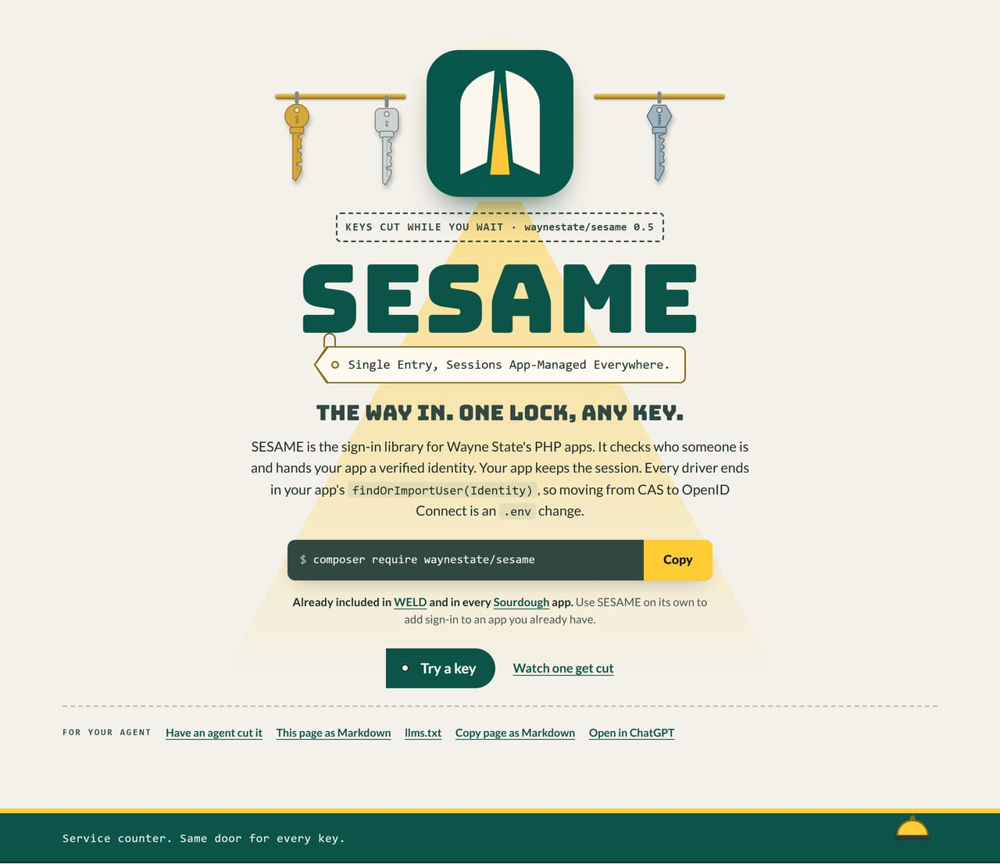

  

# SESAME

  
  
  
  

**The way in. One lock, any key.** Single Entry, Sessions App-Managed Everywhere: keys cut while you wait, and no
key ever gets to keep the door.

Checks: `composer ci` (the same command runs on GitLab and GitHub). Both pipelines run the same five checks (manifest, tests, Pint, PHPStan, audit), so a green build means the same thing on both sides.

Our CI is the same script on both sides, so when it fails, nobody gets to blame the other platform.

SESAME is Wayne State's protocol-neutral auth library. It returns a verified
identity and leaves the session to the app: every driver ends in the same
place, the app's `findOrImportUser(Identity)`, and the protocol never holds
the session. Switching driver is a config change with no code change. Open
sesame.

Front page: [`site/index.html`](../index.html), a static page you can open in a browser or serve from `site/`.
On Citadel it is served by the raw-PHP deploy layer in [`deploy/`](https://nougat.snu.gs/enterprise-apps/sesame): a Squire kit whose front controller serves `site/` behind HELMET's security headers. For local development, keep serving `site/` directly.

## Environment variables

Every environment variable SESAME reads, what it does, and its default. The table is generated from the source by
Squire's docs builder; do not edit it by hand.

<!-- generated:env -->
| Variable | Meaning | Default | Read in |
| --- | --- | --- | --- |
| SESAME_CAS_ASSUME_MFA | Count a successful validation as an MFA sign-in; on only when the CAS server enforces MFA for every sign-in | `false` | config/sesame.php |
| SESAME_CAS_BASE_URL | The CAS server's base URL (no trailing slash, including the path the server lives under; Academica is `/cas`) | none (Playbook supplies the WSU value) | config/sesame.php |
| SESAME_CAS_PROTOCOL | The CAS protocol version; set `3.0` when the server releases attributes on `/p3/serviceValidate` | `2.0` | config/sesame.php |
| SESAME_CAS_RENEW | Send `renew=true`; leave off against Academica, which issues no ticket for it | `false` | config/sesame.php |
| SESAME_CAS_SERVICE_URL | The URL the CAS server sends the user back to after verifying them | none (the app's `/login` route) | config/sesame.php |
| SESAME_DRIVER | The protocol SESAME uses to verify identities: `cas`, `gateway`, `oauth2`, `oidc` or `fake` | `cas` | config/sesame.php |
| SESAME_FAKE_USERNAME | The identity the `fake` driver returns, for local development | none | config/sesame.php |
| SESAME_GATEWAY_ALGORITHM | The assertion's signature algorithm (`ES256`, `RS256` or `EdDSA`) | `ES256` | config/sesame.php |
| SESAME_GATEWAY_ALLOW_WITHOUT_REPLAY_GUARD | Skip the replay guard entirely; local development only, never in production | `false` | config/sesame.php |
| SESAME_GATEWAY_AUDIENCE | The audience claim the gateway assertion must carry | none | config/sesame.php |
| SESAME_GATEWAY_HEADER | The header the Drawbridge gateway sends its signed JWT assertion in | `X-Sesame-Assertion` | config/sesame.php |
| SESAME_GATEWAY_ISSUER | The issuer claim the gateway assertion must carry | none (Playbook supplies the WSU value) | config/sesame.php |
| SESAME_GATEWAY_LEEWAY_SECONDS | Clock skew allowed on the assertion's time claims, in seconds | `30` | config/sesame.php |
| SESAME_GATEWAY_MAX_LIFETIME | The longest an assertion may live, in seconds; longer ones are refused | `300` | config/sesame.php |
| SESAME_GATEWAY_PUBLIC_KEY | The gateway's public key: a PEM string or a path to one for ES256 and RS256, a base64-encoded raw key or a path to one for EdDSA | none (set this or `public_keys`, not both) | config/sesame.php |
| SESAME_GATEWAY_REPLAY_STORE | The cache store used jtis are kept in, so a captured assertion cannot be replayed | none (the app's default cache store) | config/sesame.php |
| SESAME_GATEWAY_TRUSTED_PROXIES | Comma-separated CIDR ranges (or single IPs) the gateway proxy sits behind; the request must come from one of them | none | config/sesame.php |
| SESAME_LOG | Log sign-in and sign-out events through the app's PSR-3 logger | `true` | config/sesame.php |
| SESAME_MFA_MAX_AGE | How long a verified MFA sign-in stays good, in seconds | `28800` (eight hours) | config/sesame.php |
| SESAME_MFA_ON_FAILURE | What the `sesame.mfa` middleware does when the check fails: `deny` answers 403, `reauth` sends the user back to the login route | `deny` | config/sesame.php |
| SESAME_OAUTH2_AUDIENCE | The audience claim the token must carry (for Entra, the app's client id) | none | config/sesame.php |
| SESAME_OAUTH2_IDENTITY_CLAIM | The claim the username comes from: `preferred_username` or `accessid` | `preferred_username` | config/sesame.php |
| SESAME_OAUTH2_ISSUER | The issuer of the JWT bearer tokens (Microsoft Entra ID first: the tenant's v2.0 endpoints) | none (Playbook supplies the WSU value) | config/sesame.php |
| SESAME_OAUTH2_JWKS_CACHE_TTL_SECONDS | How long the fetched key set is kept, in seconds; refetched at most once a minute for an unknown key id | `3600` | config/sesame.php |
| SESAME_OAUTH2_JWKS_STORE | The cache store the key set is kept in | none (the app's default cache store) | config/sesame.php |
| SESAME_OAUTH2_JWKS_URL | The issuer's key set (JWKS) the tokens are verified against | none (Playbook supplies the WSU value) | config/sesame.php |
| SESAME_OAUTH2_LEEWAY_SECONDS | Clock skew allowed on the `exp` and `nbf` checks, in seconds | `60` | config/sesame.php |
| SESAME_OAUTH2_REQUIRE_AT_JWT | Check the access token's `typ` header is `at+jwt` or `application/at+jwt`; off because Microsoft Entra v2 tokens are typed `JWT` | `false` | config/sesame.php |
| SESAME_OIDC_ASSUME_MFA | Count an OIDC sign-in as an MFA sign-in | `false` | config/sesame.php |
| SESAME_OIDC_AUTHORIZATION_ENDPOINT | Override the authorization endpoint from the discovery document | none (from discovery) | config/sesame.php |
| SESAME_OIDC_CACHE_STORE | The cache store the discovery document and key set are kept in | none (the app's default cache store) | config/sesame.php |
| SESAME_OIDC_CACHE_TTL_SECONDS | How long the discovery document and key set are cached, in seconds | `3600` (maximum 3600) | config/sesame.php |
| SESAME_OIDC_CLAIMS | The ID token claims passed through to the user resolver as identity attributes, comma-separated | `wsu_roles,accessid` | config/sesame.php |
| SESAME_OIDC_CLIENT_AUTH | Client authentication on the token call: `client_secret_post` or `client_secret_basic` | `client_secret_post` | config/sesame.php |
| SESAME_OIDC_CLIENT_ID | The provider app registration's client id | none | config/sesame.php |
| SESAME_OIDC_CLIENT_SECRET | The provider app registration's client secret; read from the environment only, never logged | none | config/sesame.php |
| SESAME_OIDC_END_SESSION_ENDPOINT | Override the end-session endpoint from the discovery document | none (from discovery) | config/sesame.php |
| SESAME_OIDC_ISSUER | The OpenID Connect issuer for browser sign-in (Microsoft Entra ID first) | none (falls back to `SESAME_OAUTH2_ISSUER`; Playbook supplies the WSU value) | config/sesame.php |
| SESAME_OIDC_JWKS_URI | Override the JWKS URI from the discovery document | none (from discovery) | config/sesame.php |
| SESAME_OIDC_LEEWAY_SECONDS | Clock skew allowed on the ID token's time claims, in seconds | `60` | config/sesame.php |
| SESAME_OIDC_POST_LOGOUT_REDIRECT_URI | When set, logout sends the user through the provider's end-session endpoint | none | config/sesame.php |
| SESAME_OIDC_REDIRECT_URI | The redirect URI; must be registered on the app registration as a Web redirect URI | none (the app's `/login/callback` route) | config/sesame.php |
| SESAME_OIDC_ROLES_CLAIM | The ID token claim the roles come from (a JSON list) | `wsu_roles` | config/sesame.php |
| SESAME_OIDC_SCOPES | The scopes requested on the authorization call, space-separated | `openid profile email` | config/sesame.php |
| SESAME_OIDC_STEP_UP_ACR_VALUES | The `acr_values` parameter a step-up login request adds | none | config/sesame.php |
| SESAME_OIDC_STEP_UP_CLAIMS | The `claims` parameter a step-up login request adds | none | config/sesame.php |
| SESAME_OIDC_STEP_UP_MAX_AGE | The `max_age` parameter a step-up login request adds | none | config/sesame.php |
| SESAME_OIDC_STEP_UP_PROMPT | The `prompt` parameter a step-up login request adds | `login` | config/sesame.php |
| SESAME_OIDC_TOKEN_ENDPOINT | Override the token endpoint from the discovery document | none (from discovery) | config/sesame.php |
| SESAME_OIDC_USERNAME_CLAIM | The ID token claim the username comes from | `accessid` | config/sesame.php |
| SESAME_OIDC_USERNAME_FALLBACK | Use the `preferred_username` prefix when the username claim is missing; off because preferred_username is user-changeable | `false` | config/sesame.php |
| SESAME_ROUTES | Register GET `/login`, POST `/logout` and (for oidc) GET `/login/callback`; false keeps the routes in the app's own route file | `true` | config/sesame.php |
| SESAME_SESSION_ABSOLUTE_MINUTES | The absolute lifetime in minutes: the longest a session may live, no matter how active it is | `720` | config/sesame.php |
| SESAME_SESSION_IDLE_MINUTES | The idle timeout in minutes: the quiet time after which the session is dropped | `120` | config/sesame.php |
| SESAME_USER_RESOLVER | The class that turns a verified identity into the app's user; it must implement `Waynestate\Sesame\UserResolver` | none | config/sesame.php |
<!-- /generated -->
